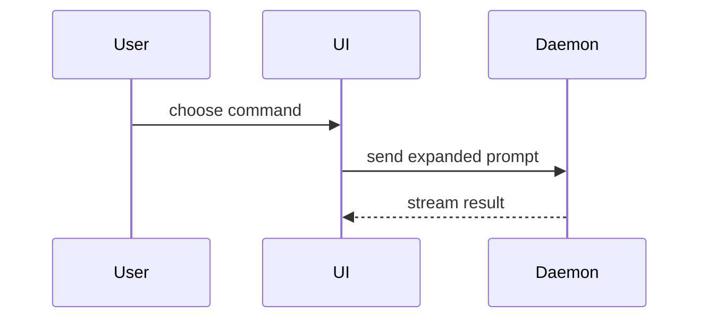

Use this template for writing the PR body:

```markdown
## Summary

<diagram, diff-sketch, or tree>

**Delivery:** <source spec Issue and accepted scope; target: main>
Refs #<spec-issue>

## Evidence

- **Before:** <screenshot/output/failing test run>
  **After:** <screenshot/output/passing test run>

## Merge Danger

**Risk / Route:** <final pr-risk level and route; reviewed head>

**Basis:** <both independent assessments and report link>

**Rollback:** <concrete recovery and irreversible effects>

**Human attention:** <required decisions or none under the verified low-risk route>

**Door:** <one-way or two-way>

<optional: description>

**Blast Radius:** <one-word description>

<optional: potential ramifications of merge>
```

## Sections

One spec Issue, titled `spec: `, has one delivery PR targeting main. Link that
source Issue directly. Keep `Refs #N` while any acceptance requires a post-merge
operation, then close the Issue explicitly after acceptance under existing
authorization. Use `Fixes #N` only when merge is the last remaining acceptance
condition and closure is authorized. Follow the tracker closing rule for commit
keywords and Development links as well as the PR body. Keep tickets in the existing local run
plan; several commits or internally parallel steps feed this same PR. Continue
the existing PR for feedback and repairs instead of creating a PR per ticket.

Before ready for merge review, verify the pre-merge local steps and acceptance,
current-head checks/reviews and report publication. List post-merge steps and
their prerequisites as pending, not completed. Close the source Issue only after
actual main integration and all remaining acceptance, with existing authorization.

For historical stacked or follow-up integration PRs, retain the original
PR/commit/Issue chain and distinguish feature-branch merges from main delivery.
Do not bulk rewrite historical links. Retargeting an old open PR requires a new
prepared run, checks and both reviews even if its head SHA did not change.

Skip all preambles and keep prose brief. Use the user's domain language from `GLOSSARY.md`.

### Summary

Pick the smallest view that makes the key point clear.

- Show logic or an algorithm as pseudocode:

```text
on(save)
  if content is unchanged
    return cached result
  write new content
  return fresh result
```

- Show runtime control flow as a call tree:

```text
submitForm
  createSession
    persistPrompt
    launchAgent
  navigateToSession
```

- Show UI structure as a component tree, including state and module boundaries that matter:

```text
<SessionPage> (apps/example/src/routes/session.tsx)
  useSessionEvents()
  <SessionToolbar>
    <RunSkillButton> (packages/ui)
```

- Show file responsibility or a broad refactor as a shallow file tree:

```text
src/
├── commands/       # parses user actions
├── sessions/       # owns session state
└── transport/      # sends API requests
```

- Show component interaction, control flow, or data flow with Mermaid:



- Use `diff` when the point is what changes and the surrounding shape already exists. Match the diff shape to the topic.

For a component change:

```diff
 <SessionPage>
   useSessionEvents()
   <SessionToolbar>
+    <RunSkillButton />
   <SessionTimeline>
+    <SkillResultCard />
```

For a file-layout change:

```diff
 src/
 ├── commands/
+│   └── show-me.ts       # expands the slash command
 ├── sessions/
-└── transport.ts
+└── transport/
+    ├── client.ts
+    └── stream.ts
```

For a call-tree or call-stack change:

```diff
 submitForm
   createSession
     persistPrompt
+    expandSkillMention
     launchAgent
-  navigateToSession
+  navigateToSession
+    subscribeToEvents
```

For a state or control-flow change:

```diff
 on(save)
-  write content
+  if content is unchanged
+    return cached result
+  write new content
+  invalidate cache
```

- Show the whole block when most of it is new, when omitted context would hide ownership or order, or when the user needs a copyable target shape:

```ts
function expandSkill(command: string): string {
  const skillName = command.slice(1);
  return `use the ${skillName} skill`;
}
```

#### Guidance

Place each visual next to the short text it supports. Keep only the calls, files, props, states, and boundaries needed to answer the user's current question or the options to resolve the current discussion point.

You may use one of these, you may use several, it is unlikely you will use all of them. Use your judgement and don't overwhelm the user.

### Evidence

Concrete evidence that the change works. Show a before and after.

Screenshots are S-tier - when the environment is set up for it and the change is visual.

Execution-based evidence is A-tier. Test results, console output. Show the exact test that now fails and passes, using pseudocode.

### Merge Danger

Use the canonical [pr-risk policy](../pr-risk/SKILL.md) and the current-head
Standards/Spec assessments. Show the final level, route and concrete reasons;
do not derive a low classification from PR size, CI or the author alone. Preserve
the distinction between `autoMergeCandidate` and the coordinator's completed
report-readback and pre-merge acceptance checks. Keep remaining human decisions
and post-merge acceptance visible.

Describe whether it's a one-way or two-way door. You can walk back through two-way doors, but not one-way doors. A PR that is cheap to roll back is lower risk. Changes that involve destructive actions or hard-to-reverse decisions are one-way doors.

The blast radius is the potential impact or scope of the changes introduced by this PR. Consider all possibilities. Examples are layout shift, breakages for consumers, mobile responsiveness, etc.
