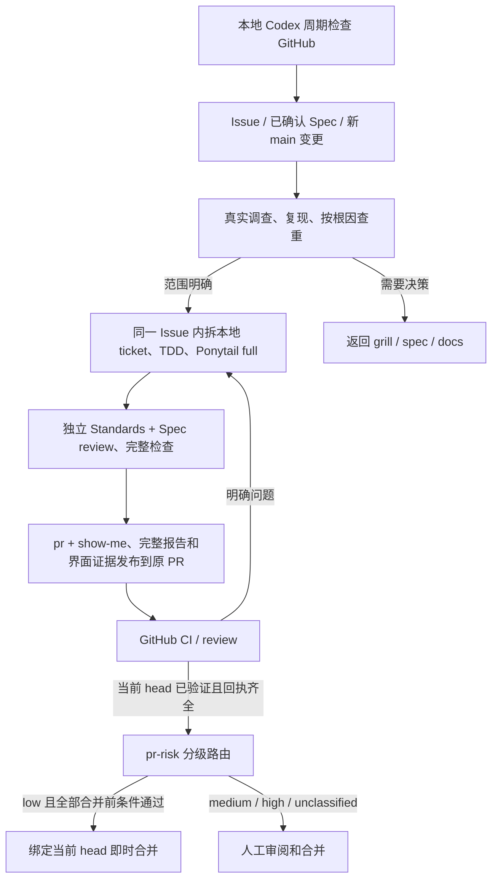

# 本地订阅 Agent 工作流

执行入口为本机 Codex 的 ChatGPT 登录。GitHub 保存 Issue、PR、review 和工程 CI；
调查、实现与反馈修复由 Codex 本地聊天自动化执行，使用订阅内的 Codex 额度并受其限额约束。

本文件负责运行环境、命令契约和 GitHub 门禁。各项规则只在一处维护：

| 主题                                   | 权威位置                                                 |
| -------------------------------------- | -------------------------------------------------------- |
| 执行步骤、资格、发布、反馈修复         | [local-agent.md](../../.agents/workflows/local-agent.md) |
| Issue 约定、标签、`Refs`/`Fixes`、关闭 | [issue-tracker.md](./issue-tracker.md)                   |
| 风险分级与合并路由                     | [pr-risk](../../.agents/skills/pr-risk/SKILL.md)         |
| 审查报告、界面证据与发布回执           | [pr-evidence.md](./pr-evidence.md)                       |
| 讨论读取与反馈回复                     | [discussion-workflow.md](./discussion-workflow.md)       |
| 父子 Issue、叠加 PR、旧 run            | [legacy-recovery.md](./legacy-recovery.md)               |
| 领域词汇                               | `CONTEXT.md`                                             |



## 运行方式与计费

机器和 Codex 桌面应用需要保持运行。使用当前聊天的 heartbeat，每五分钟检查一次；
这属于轮询，不承诺 webhook 实时响应。应用离线、订阅限额耗尽或连接器失效时不能执行，
恢复后重新读取 GitHub 状态；不切到付费 API，不把失败报告为没有任务。

```bash
bun run agents:check        # 检查协议、skills 和仓库中是否残留托管 API 执行入口
bun run agents:local-check  # 另检查本机 ChatGPT CLI 登录及 API-key 环境变量
bun test tests/agent-issue.test.ts tests/pr-feedback.test.ts tests/defect-scan.test.ts
```

GitHub CI 只执行第一个命令，不需要本机登录或 OpenAI API key。`agents:check` 只验证
仓库执行契约，不能证明调度器已启用或某个任务已经完成；本地登录检查也不证明剩余额度。

GitHub 操作优先使用本地 Codex 已连接的 GitHub 工具；已登录的 Git client 也可使用。
不要求复制连接器凭据或创建 `AGENT_PR_TOKEN`。个人 `auth.json`、订阅登录文件和 API key
都不能上传到 GitHub；本方案不安装公开仓库的 self-hosted Actions runner。证据 publisher
使用 Actions 自带的 GitHub token。官方说明见
[认证](https://learn.chatgpt.com/docs/auth#openai-authentication)、
[自动化认证](https://learn.chatgpt.com/docs/non-interactive-mode#authenticate-in-automation)和
[本地聊天定时任务](https://learn.chatgpt.com/docs/automations#schedule-a-task-inside-a-chat)。

在 Codex Scheduled 中关闭这条本地自动化可停止新调度，正在运行的 turn 另行取消。

## 命令契约

执行使用版本管理的 `scripts/local-agent.ts`。每次 Issue 或 PR 反馈请求有独立 run 目录，
通常放在 `$CODEX_HOME/local-workflows/nodebraid/runs/<run-id>/`。

```bash
bun run agents:run archive-issue snapshot.json ~/.codex/local-workflows/nodebraid/issues
bun run agents:run normalize raw-github.json published-feedback.json snapshot.json
bun run agents:run reconcile reconciliation-source.json reconciliation.json
bun run agents:run prepare task-input.json /absolute/path/to/run
bun run agents:run frontier /absolute/path/to/run completed-steps.json
bun run agents:run inspect /absolute/path/to/run
bun run agents:run verify /absolute/path/to/run reviews.json decisions.json
bun run agents:run publication /absolute/path/to/run actual-remote-commit.json
bun run agents:run evaluate /absolute/path/to/run snapshot.json publication-receipt.json
```

### prepare 与 frontier

`task-input.json` 的字段为 `run`、`repository`、`source: {kind: issue|pr, number}`、
`branch`、当前 PR 目标分支 `baseRefName`、完整 SHA `base`、完整 SHA `expectedParent`、
原始请求摘要 `request`、待处理反馈 `pending`，以及 `plan: [{id, blockedBy, acceptance}]`。

- `base` 是目标分支本次读取的提交，作为 review、完整 binary patch、验证、preview 与
  report 的共同审查起点。
- `expectedParent` 是本轮发布必须追加的远端源分支 head；新分支尚不存在时使用刚 fetch
  的目标提交。初次发布二者通常相同，追加修复和同步 main 时可以不同。二者都必须在执行前
  从独立来源保存，不能从发布响应倒推，也不能互相代替；本地验证提交必须包含二者的祖先历史。
- `pending` 来自完整归一化快照的 `evaluateFeedback` 结果。

`prepare` 独立写入 `prepared-task.json`；相同输入可恢复，变更输入需要新 run，不能从结果
receipt 复制一个“预期 task”。`plan` 的 step 就是本地 ticket，用描述性 ID，不用 Issue 编号。
`frontier` 读取已有执行证据的已完成 step ID 数组，拒绝未知 step、环和越过未完成 blocker。

### inspect、verify 与 publication

`inspect` 输出当前完整 head、tree 和原始 `git diff --binary <base> HEAD` 的 SHA-256。
`reviews.json` 是 `{standards, spec}`，每轴包含 `head`、`tree`、`patch`、实际 `report`、
`verdict: passed|changes-requested|needs-design` 和
`risk: {level: low|medium|high, rationale, evidence, rollback}`（后三项为非空字符串）。
仅两轴均 passed 且分级完整才可启动验证。`decisions.json` 必须恰好覆盖原 pending 的
key/digest、处置和原因。

`verify` 在干净提交上运行真实 `bun run check`，从 Git diff 捕获 `changedFiles` 并应用
`pr-risk` 路径下限。每次尝试保留唯一日志并检查运行前后 source 未变；失败结果写入
`verification.json`，原始日志不覆盖，同一 head 的新尝试也重新执行，不缓存或跳过。

`publication` 读取 GitHub Git commit 原始返回值 `{sha, tree: {sha}, parents: [{sha}]}`：
远端 tree 必须等于已检查 tree；第一父提交必须是 `expectedParent`；实际父提交中至少一个
包含审查 `base` 的祖先历史。发布前须使这些父提交对象在本地可读；Git 读取错误直接失败。
API 生成的远端 SHA 可以不同，但一份 run 不得绑定第二次发布。先记录发布再调整本地 ref。

### normalize 与 evaluate

`normalize` 的输入契约为 `scripts/github-feedback.ts` 的 `GitHubFeedback`：PR 的
`base.sha` 归一化为 `baseRefOid`，缺失时明确失败。`comments`、`reviews` 为每页 100 条的
REST page 数组，包含最后短页（恰好 100 条时还要读空页）；`threads` 读完外层页和评论
cursor；CI arrays 匹配报告总数。实际 workflow 的 head/path/name 用于识别项目 Checks，
workflow 自身的 pending/failure 也保留；combined-status 响应的 `sha` 必须是当前 head。
普通 COMMENTED 不能清除同一人的 changes requested。`published-feedback.json` 仅含已发布且
key/digest 精确匹配的自己评论。

`evaluate` 读取 run 的 `verification.json`、`publication.json`、当前快照和
[发布回执](./pr-evidence.md#发布回执)。新 head 或目标分支名改变返回 `waiting-verification`；
目标为 `main` 时仅目标 SHA 前进不使已验证 run 失效，冲突由 `CONFLICTING` 进入 `repair`。
其余为 `repair`、`waiting-ci`、`waiting-review`、`needs-integration` 或 `ready`；
反馈与 CI 已就绪但回执缺失或不指向当前 head 的完整报告时返回 `waiting-evidence`。
结果另含 `risk: {level, route, reasons}` 与 `autoMergeCandidate`（仅 ready 且 low 时为 true）。
它不读取本地 ticket 完成记录，合并前 ticket/验收仍由协调者核对。

### reconcile

`reconcile` 是只读对账命令，不写 GitHub、不 merge、不关闭 Issue；可选第二个参数保存报告。
契约为 [`ReconciliationInput`](../../scripts/local-agent-reconcile.ts)，不能从上一份成功报告倒推：

- `repository: {full_name, default_branch}` 来自仓库元数据；`main` 为刚 fetch 的
  `refs/remotes/origin/<default_branch>` SHA。命令对每个 merged PR 的真实
  `merge_commit_sha` 执行 Git 祖先检查；提交缺失或 Git 错误直接失败。
- `actor` 为当前 GitHub 用户，`executor` 为当前执行聊天身份。`closeAuthorization`
  记录已有用户关闭授权的来源，没有授权填空字符串；它不代表合并权限。
- 新需求使用 `specs: []`，每个交付 Issue 在 `tasks` 中出现一次，`parent: null`。
  `blockers` 只装真实外部 Issue 依赖的完整 REST 分页，无依赖时为 `[[]]`，不填本地 step ID。
- 每个条目保留完整 `issue`（正文、评论、标签、assignees、`OPEN|CLOSED` 状态），从真实讨论
  确认的 `approval` 来源链接或 null、`execution: agent|local-only|paused`、当前 `owner`
  或 null、全部 `acceptance: [{id, evidence}]`（未完成证据为 null，不能省略）。
- `pullRequests` 为该需求的唯一 PR（创建前为空），`delivery` 是该 PR number 或 null。
  顶层 `pullRequests` 保留实时 `number/title/state/draft/head/base/merged/merge_commit_sha/html_url`，
  每个 `base.repo.full_name` 必须是当前仓库。历史 `specs` 聚合见
  [legacy recovery](./legacy-recovery.md#parentchild-issues)。

报告包含交付 `frontier`、`integration` 候选、PR 集成状态、未完成验收和关闭候选 `canClose`。
证据字段是来源引用，helper 不读取 URL 内容；候选不是执行授权或完成证书。

### 主动调查与 discovery

在干净、已 fetch 的 main worktree 中执行 `bun run agents:scan [last-reviewed-sha]`
（首次省略），写入忽略的 `.tmp/agent-defect-scan.json`。调查失败或 Issue 未实际发布时不推进基线。

```bash
bun run agents:discovery init /absolute/path/to/discovery.json
bun run agents:discovery sync /absolute/path/to/discovery.json
bun run agents:discovery finish /absolute/path/to/discovery.json report.json
```

首次显式 `init`，保守地将所有现存 package、workflow、docs 和 examples 标为 pending；
缺失或损坏的状态直接报错，不静默重建。`sync` 保留未完成和已删除 package 的调查记录，
只有受影响的已完成 seam 会重新排队。`report.json` 含 `seam`、`head`、`evidence`、
`remaining: [剩余公共接口的唯一名称]`（全部完成时为 `[]`）和
`commands: [{command, exitCode}]`。命令失败、报告缺失或过期不会清掉 pending；成功报告
保存成不可变 evidence 文件再原子更新队列，相同报告恢复不会重复完成。

### 工作流复盘

```bash
bun run agents:retro
```

读取 `$CODEX_HOME/local-workflows/nodebraid/runs/`，自动从上次复盘结束的时间点继续，
在终端打印报告并保存到同级 `retros/<时间>/`；不写 GitHub。需要时可用 `--since` 指定起点、
`--threshold` 调整信号阈值（默认 3）。`retro.json` 含 `summary` 与每个信号的
`proposals: [{key, title, body}]`，正文首行为 `<!-- workflow-retro:<key> -->` 去重标记。`retro.json` 摩擦记录格式错误时直接失败；
时间来自产物修改时间，只作近似。发布 proposal 的规则见
[local-agent.md](../../.agents/workflows/local-agent.md#workflow-retrospective)。

### 证据命令

`agents:preview --base <sha> (--out <empty-dir> | --plan) [--all]`、
`agents:report <run-dir> <output-dir>` 与 `agents:publish-evidence` 的参数、schema 和
发布步骤见 [PR 证据](./pr-evidence.md)。preview 的 `--base` 使用 prepared task 的审查 `base`。

## GitHub 合并门禁

默认分支使用独立的 `main-pr-and-checks` ruleset：required PR、由 GitHub Actions 上报的
`checks`、讨论解决、非快进/删除保护，且只允许 squash 合并。不要求分支基于最新 main
（`strict_required_status_checks_policy: false`）：PR 已验证的 diff 合入后由 main 上的
push `Checks` 兜底，冲突仍阻止合并。单人维护时 approving review count 为 0；分级路由不修改
该设置，也不能绕过实际所需的批准。原 disabled `deny` 规则含限制所有更新等其他策略，不能
直接启用代替上述配置。

可审查的请求正文保存在 `docs/agents/main-ruleset.json`；它只是配置输入。只有读回 active
rules 及默认分支后才能报告生效。管理操作需要已有 GitHub 管理登录；连接器不能写 rulesets
或认证失效时保留错误。不能通过关闭 TLS 校验、复制连接器凭据或调用付费模型完成配置。

## 验证范围

开发迭代执行 `bun run check:affected`，按行为增加公共 seam red/green、状态序列、故障注入、
真实 Chromium、声明隔离或 package 消费测试。正式交付的全量 `bun run check` 由
`agents:run verify` 执行，GitHub CI 另行全量检查。具体选择来自任务风险；不宣称每个包都已
拥有属性测试、状态模型或故障注入。

本地执行层测试使用隔离 Git 仓库和真实子进程，覆盖检查失败/恢复、task 不可重绑、新 head、
分页和依赖前沿。这些 fixture 结果与真实远端 CI/review 修复验收分开记录；未真实触发的线上
分支继续标为 unverified。
