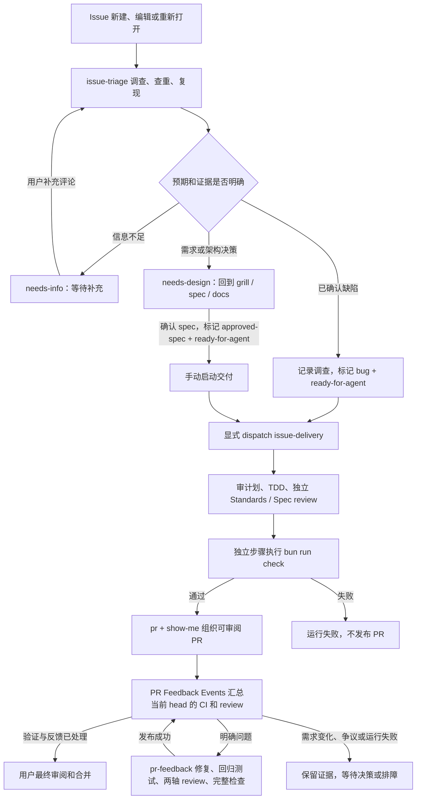

# GitHub Agentic Workflows

本项目用 gh-aw **v0.89.21** 和 Codex 执行 GitHub issue 调查与任务交付。
`.github/workflows/*.md` 是执行源；对应 `.lock.yml` 是 Actions 必须读取的编译产物，两者都提交。

## 执行链路



调查可以由任何 issue 提交者触发，使用可信默认分支的源码；补充评论仅在
`needs-info` issue 上由用户评论触发，排除 PR 评论和机器人评论。调查不会修改
原始 issue 内容或关闭 issue。启动时间取决于 runner 排队，不承诺即时完成。

交付接收一个 issue 编号，并在启动 Agent 前重新读取当前状态。编号不合法、issue
已关闭、缺少执行标签或仍需讨论会明确失败。同一 issue 的交付串行处理；已有修复
PR 时报告链接，不重复创建。`GITHUB_TOKEN` 的标签写入不会触发另一个 workflow，
因此调查通过 safe output 显式 dispatch，不能只用标签事件串接。

## 人与 Agent 的职责

用户参与 grill、spec、领域文档和公共测试 seam 的确认，以及最终 PR 查看和合并。
确认后，Agent 自主拆分纵向任务、独立审计划、实现、测试、review、修正并整理 PR。
需求、公开契约或 ADR 决策变化时回到前期讨论，禁止为通过测试擅自改验收条件。

交付安装 checkout 中的 `tdd`、`code-review`、`ponytail`、`ponytail-review`、`pr`、`show-me` 本地 skills；不在
运行时下载浮动的上游版本。`CONTEXT.md` 是本项目词汇表，兼容技能中的
`GLOSSARY.md` 名称。保留 vendored skill 原文，在项目规则中明确自主执行范围。

### Ponytail 的职责

计划和实现采用 `ponytail` 的 full 模式：先读受影响代码、调用者和已有能力，优先复用，
以最小充分改动完成整个任务。Standards reviewer 同时使用 `ponytail-review`，检查修改
影响到的调用链、风险、新逻辑的测试和不必要的复杂度，发现合并到该轴，不增加重复审查轮次。
Spec review 仍独立核对需求，最终工程检查仍由 runner 执行。

精简以已确认的 spec、ADR 和公共契约为依据；框架 seam 不因当前只有一个实现而删除，
也不为减少代码量裁掉错误处理、回归测试或结构验证。技能的英文输出约定服从项目中文约定。

本次仅安装项目级 skills，不安装全局插件或生命周期 hooks。两项 Ponytail 源文件固定自
[`DietrichGebert/ponytail@09c434a`](https://github.com/DietrichGebert/ponytail/tree/09c434ab73ca43761c5d8b0c5d341926c2fba710)，
原文和 MIT license 一起保留在 `.agents/skills/`，以仓库提交记录为版本依据。

### 从其他工作流借鉴的闭环机制

| 来源                                                                                                                               | 值得借鉴的机制                                                  | 本项目当前状态                                                                |
| ---------------------------------------------------------------------------------------------------------------------------------- | --------------------------------------------------------------- | ----------------------------------------------------------------------------- |
| [Matt implement-spec](https://github.com/mattpocock/skills/blob/main/skills/engineering/implement-spec/SKILL.md)                   | 依赖图、独立 worktree、集成负责人验证每个结果                   | 已有主 Agent 拆任务、审计划与集成规则                                         |
| [Matt diagnosing-bugs](https://github.com/mattpocock/skills/blob/main/skills/engineering/diagnosing-bugs/SKILL.md)                 | 先建立能捕获原始症状的运行命令，再缩小复现和修复                | issue 调查已有公共 seam 复现与 red/green 要求                                 |
| [pstack PR 维护](https://github.com/michael-denyer/pstack-claude/blob/main/plugins/pstack/skills/poteto-mode/playbooks/babysit.md) | 按当前 head 检查 CI、review 反馈与 mergeability，修复后重新验收 | PR 事件控制器与 gh-aw 修复 worker 已接入，合并后执行线上验收                  |
| [pstack 决策记录](https://github.com/michael-denyer/pstack-claude/blob/main/plugins/pstack/skills/show-me-your-work/SKILL.md)      | 记录决策、原因、证据链接和结果，交接时核实证据                  | runner 校验反馈处置、request、base、实际 commit；控制器核实运行成功和分支归属 |

这些是协议对照，不代表安装了 pstack 全套路由，也不采用上游固定修复轮数、自动 fallback
或额外的人工作业门槛。Ponytail 优化实现和审查，不负责调度或关闭 PR 反馈环。

Review 使用同一份完整 workspace patch，包含新增文件；仅看 `base...HEAD` 会漏掉
未提交修改。记录 base commit、patch digest、验收条件、实际命令结果、两轴审查结果。
修正后复验并更新证据。详细日志留在运行记录，PR 使用结构图、Before/After 证据和影响范围。

## PR 发布后的反馈闭环

`issue-delivery` 创建 `[agent] ` 标题前缀、`feat/issue-<number>` 分支的 PR，显式加入自动维护。
只处理本仓库发往 `main` 的开放、非 draft PR；fork 和普通人工 PR 不自动修改。
移除标题前缀或转为 draft 即可退出。关闭 `PR Feedback Control` workflow 可停止同步和
新修复派发；已经运行或排队的 `Agent PR Feedback` 需要在 Actions 另行取消。

普通 Actions `pr-feedback-events.yml` 仅产生无写权限的事件信号。其作业结束后，
`pr-feedback-control.yml` 通过 `workflow_run` 在默认分支运行，避免控制器自身的 pending
check 留在被判断的 PR head。控制器只 checkout 可信 `main`，不安装或执行 PR 代码，
不持有 OpenAI key；仅可信 main 同步使用 `agent-publish` 中的 `AGENT_PR_TOKEN`。
它响应 PR head、review、review thread、PR 评论、Checks／修复 workflow 完成、
外部 check suite／commit status 和 `main` 更新。
每次读取所有开放的托管 PR，因此 Actions 合并同组 pending 事件时不会遗漏其他 PR。
完整读取分页的评论、review、thread 和 workflow runs，不把分页上限当成全部证据。

存在新反馈、当前 CI 失败、冲突或需要更新 base 时，控制器用默认 `GITHUB_TOKEN` 显式
dispatch `pr-feedback.lock.yml`。输入绑定 PR 编号、完整 head SHA 和反馈指纹；启动前再次
核对并 checkout 精确 PR head。旧请求明确报 superseded；同一个 PR 的修复串行执行，
新 head 或新反馈在后续 reconciliation 中重新判断，不复用旧 head 的 CI 结果。

Worker 使用 TDD、Ponytail、独立 Standards／Spec review、`pr`／`show-me` 证据方式。
真实缺陷自主修复；错误或不适用的 review 建议给出证据；产品、公开契约或架构变化返回
设计讨论。每条反馈都记录 `addressed`、`not-actionable` 或 `needs-design` 及理由。
CI 修复不允许弱化测试或绕过检查。修改提交在原 PR 分支上，仅追加 commit；需要更新
base 时由可信控制器用 GitHub merge API 将固定 main SHA 合入原 PR 分支，不 rebase 或
force push。这样 gh-aw v0.89.21 不会把 main 已批准的 README／配置改动误当成 Agent
patch，仍完整保留 protected-files 保护。API 无法干净合并的冲突会记录为显式失败，
继续处理其他 PR；该 PR 必须先解决 base 冲突再恢复，不能声称已经闭环到可合并。

可信脚本在切换 PR 前复制到 runner 的只读控制目录；post-step 从该目录独立核对 request、
base、当前实际 commit、完整反馈处置和干净工作树，并执行 `bun run check`。成功后上传
`pr-feedback-result` artifact。只有**整个修复运行成功**且 commit 可从当前 PR head 到达，
控制器才将 artifact 发布为可回放的 PR 结果评论。发布失败、旧分支或人工伪造的评论标记
不能作为成功交接。评论或 thread 被编辑、补充后，其内容摘要变化，必须重新调查；
已解决 thread 上的新回复也会重新进入反馈队列。

结果发布后等待真实 CI。项目 `Checks / checks` 必须成功，已报告的其他 CI 不能有失败或
pending；再结合 GitHub `mergeable`、`mergeStateStatus`、review decision 和未解决 thread
判断状态。只有内容未变化、处置绑定当前 head、已记录 `addressed` 且 CI 通过的 thread
自动 resolve。旧 head 上仍未关闭的 thread 必须重新调查其在新 head 上的适用性。
争议 thread 保留给审阅者；绝不代替人批准、dismiss `changes requested` 或解除分支保护。
`REVIEW_REQUIRED` 单独显示等待人工审阅，不能声称已经满足全部合并条件。最后由用户审阅和合并。

同一反馈指纹用已有 workflow run 去重，不给修复轮数加固定上限。已失败的运行明确展示
原始链接；不会把缺少凭据等运行错误当成代码修复成功，也不会对不变的失败持续空转。
新评论、CI 重跑结果或新提交会触发重新判断。排障后可在 Actions 重跑失败的
`Agent PR Feedback` 运行；手动运行事件控制器只是重新读取状态，不绕过反馈去重。

控制脚本的公开测试 seam 为状态评估与交接校验：

```bash
bun test tests/pr-feedback.test.ts
```

覆盖当前 head CI、反馈指纹去重、review 编辑、设计问题、GitHub 合并门禁、交接遗漏／伪造。
编译和这些测试不代表已跑通云端 Codex；线上验收需在默认分支合并后，用真实托管 PR 分别
验证一次失败 CI 修复和一条真实 review 修复，检查新 commit、回归测试、artifact、结果评论、
当前 head 的 Checks、thread 状态及最终人工交接。中途制造新 head 应让旧请求失效；缺少
凭据、失败检查、争议建议和需求变化都必须保留可见状态。

## 启用

1. 将接入源码、编译产物、脚本、说明和已安装的 `pr` / `show-me` 一起提交到 PR，
   合并到默认分支 `main` 后 issue 事件才会触发。
2. 在仓库 Settings → Secrets and variables → Actions 配置：
   - `CODEX_API_KEY`：OpenAI API key；gh-aw 也接受 `OPENAI_API_KEY`，两者只需一个。
     此入口使用 API 计费，不能直接复用桌面 ChatGPT 订阅登录。
3. 创建 GitHub Environment **`agent-publish`**，仅在该 environment 的 Secrets 中配置
   `AGENT_PR_TOKEN`，不要创建同名 repository secret。Token 使用仅授权本仓库、允许
   Contents、Pull requests、Issues 读写的 fine-grained PAT。这让发布阶段可以创建 PR
   并触发现有 CI；默认 `GITHUB_TOKEN` 创建的 PR 可能需要人工启动 CI。该 environment
   不设置逐次 required-reviewer 审批，否则会重新引入每个任务的人工作业。
4. 仓库 Actions 设置允许 GitHub Actions 创建 PR。App 的 installation token 会过期，
   使用 App 时应配置持续获取短期 token 的机制；初次接入可使用有到期日且只授权本仓库的 PAT。
5. 确保下列标签存在：`bug`、`enhancement`、`needs-info`、`needs-design`、
   `ready-for-agent`、`approved-spec`。

密钥不得写入 issue、PR、源码或日志。Agent job 的 GitHub 权限为 read；标签、评论、
dispatch 和 PR 写入由 safe-output 阶段执行。PR credential 配置在单个 PR 输出上，
只有挂载 `agent-publish` environment 的发布作业可以读取实际值。上游编译器也会在
Agent 作业的配置生成与日志脱敏步骤引用该 secret 名称；环境作用域使这些引用为空。
最终工程检查失败会阻止整个发布 job。

## 编译与检查

安装固定版本的官方 CLI（安装脚本包含校验和验证）：

```bash
curl -fsSL https://raw.githubusercontent.com/github/gh-aw/c35393777e5604a63721d09512263b1383301d4f/install-gh-aw.sh -o /tmp/install-gh-aw.sh
bash /tmp/install-gh-aw.sh v0.89.21
bun run agents:compile
bun run agents:check
```

先格式化 `.md` 源码，再编译。禁止手工重写 `.lock.yml`；`.gitattributes` 将其标为
生成文件，Prettier 忽略它们。运行时安装的 `.codex/skills/` 被 Git 和 Prettier 忽略，
不会污染产品 patch 或因上游格式导致检查失败。CI 使用同一版本检查编译和过期产物。

PR 修复复用同一组密钥和隔离环境，不新增 secret。Agent job 仍不能读取实际发布 token；
可信默认分支控制器的 main 同步和 safe-output 发布作业读取该 environment secret。
`signed-commits: false` 选择直接 append-only push，以保留机器交接中的实际 SHA；此配置
要求 PR 分支未启用签名提交保护。若启用该保护，应先调整发布和 SHA 交接协议再启用此 worker。
固定 checkout `fetch-depth: 0` 为当前小仓库预置 bundle 所需历史，不启用自动补抓历史的
fallback。`fallback-as-pull-request: false` 和 `protected-files: blocked` 保证发布失败不会
另建替代 PR 或绕过 automation／steering 文件保护。

首次线上验收：新建含真实复现步骤的缺陷 issue，检查调查评论、标签和派发运行，随后
检查修复 PR、回归测试、两轴 review 记录、完整 Checks 和 issue 关联。缺少凭据或
运行失败必须报告实际原因；仅编译成功不代表通过线上验收。

手动交付一个已批准任务：

```bash
gh aw run issue-delivery --ref main --raw-field issue_number=42
```

在 Actions 页面查看运行结果。不会自动合并 PR，也不会在 merge 前关闭源 issue。
该接入使用 gh-aw 的安全输出保护和平台自带执行限额，没有添加额外 max-turns、
重试成功路径或 PR 创建失败转 issue 的替代行为。自动化/steering 文件修改会明确受
上游 protected-files 保护；需要这类修改时走人工设计与普通 PR。

## 按行为选择验证

所有交付都执行现有 `bun run check`。Agent 按任务行为选择新增证据：

| 行为                     | 验证方式                                                             |
| ------------------------ | -------------------------------------------------------------------- |
| 明确缺陷                 | 公共 seam 的 regression red → fix → green，再复验原始场景            |
| Kernel / History 不变量  | 属性或可复现随机操作；undo/redo 恢复图内容，不假设 revision 回退     |
| Runtime / React 生命周期 | 安装、依赖失效、恢复、dispose、remount 的状态序列与可控竞态          |
| 错误处理                 | 公共 adapter 故障注入，验证原始错误、清理和恢复                      |
| SVG / Example 交互       | 真实 Chromium 输入、DOM、Kernel、History 联合验收；视觉变化附截图    |
| 对外 package 契约        | 声明隔离、package-name import、pack preview；必要时实际 tarball 消费 |

现有 Browser 测试、声明检查和 Quick Start 已是基础能力。这是选测试的协议，不宣称
所有包已经具备属性测试、状态模型或 tarball 消费测试。

## 上游参考

- [Issue triage 示例](https://github.github.com/gh-aw/gallery/ai-issue-triage/)
- [Codex engine](https://github.github.com/gh-aw/engines/codex/)
- [Safe outputs](https://github.github.com/gh-aw/reference/safe-outputs/)
- [GitHub workflow 触发规则](https://docs.github.com/en/actions/how-tos/write-workflows/choose-when-workflows-run/trigger-a-workflow)
