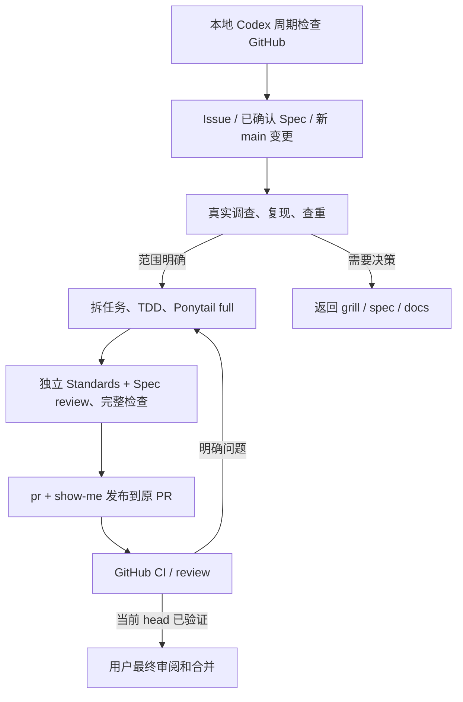

# 本地订阅 Agent 工作流

执行入口为本机 Codex 的 ChatGPT 登录。GitHub 保存 Issue、PR、review 和工程 CI；
调查、实现与反馈修复由 Codex 本地聊天自动化执行，使用订阅内的 Codex 额度并受其限额约束。
执行协议以 [local-agent.md](../../.agents/workflows/local-agent.md) 为准，领域词汇以
`CONTEXT.md` 为准。本次迁移合并后，旧 gh-aw API 执行入口删除，不同时运行两套 Agent。



## 运行方式与计费

机器和 Codex 桌面应用需要保持运行。使用当前聊天的 heartbeat，每五分钟检查一次；
这属于轮询，不承诺 webhook 实时响应。应用离线、订阅限额耗尽或连接器失效时不能执行，
恢复后重新读取 GitHub 状态；不切到付费 API，不把失败报告为没有任务。

本机已验证 `codex login status` 返回 `Logged in using ChatGPT`。检查命令：

```bash
bun run agents:check        # 检查协议、skills 和仓库中是否残留托管 API 执行入口
bun run agents:local-check  # 另检查本机 ChatGPT CLI 登录及 API-key 环境变量
bun test tests/agent-issue.test.ts tests/pr-feedback.test.ts tests/defect-scan.test.ts
```

GitHub CI 只执行第一个命令，不需要本机登录、OpenAI API key 或发布 PAT。
`agents:check` 只验证仓库执行契约，不能证明调度器已启用或某个任务已经完成。
本地登录检查也不证明还有多少剩余额度，实际限额错误仍需保留。

GitHub 操作优先使用本地 Codex 已连接的 GitHub 工具；已登录的 Git client 也可使用。
不要求复制连接器凭据或创建 `AGENT_PR_TOKEN`。个人 `auth.json`、订阅登录文件和 API key
都不能上传到 GitHub；本方案不安装公开仓库的 self-hosted Actions runner。
官方说明见 [认证](https://learn.chatgpt.com/docs/auth#openai-authentication)、
[自动化认证](https://learn.chatgpt.com/docs/non-interactive-mode#authenticate-in-automation)和
[本地聊天定时任务](https://learn.chatgpt.com/docs/automations#schedule-a-task-inside-a-chat)。

## 自主执行范围

用户参与前期 grill、spec、领域文档和公共测试 seam，以及最终审阅和合并。
确认后，Agent 自主拆分、审计划、实现、测试、独立 review 和修正，不逐票询问。
需求、公开契约、ADR 或安全策略发生变化时返回前期讨论。

实现采用 `ponytail` full：读真实调用链，优先复用，做最小充分修复。
Standards 同时应用 `ponytail-review`，Spec 独立核对原始要求。不能因精简而删除必要的
错误处理、公共 seam 或 ADR 约束。使用同一份包含新文件的完整 patch，记录 base、tree、
patch digest、命令与结果。修正后复验，详细轨迹保留在运行记录中。

Issue 标签路由见 [issue-tracker.md](./issue-tracker.md)。只有实际复现且预期已明确的缺陷，
或已确认的 spec 可以实现；风格问题、缺少测试、新需求和不明确的预期不能冒充 bug。
GitHub 是实时任务状态来源，本地 ledger 保存证据和去重元数据，不维护另一套人工任务清单。

托管 PR 使用 `feat/issue-N` 与 `[local-agent] ` 标题；也接管既有 `[agent] ` issue PR。
移除前缀、关闭 PR 或转为 draft 后不再自动处理。每次写入前重新检查当前资格和 head；
不得复用旧 head 的绿灯。新 review、编辑或已解决 thread 的新回复都需重新判断。
人类 `changes requested` 和争议 thread 不自动 dismiss／approve；需要人工批准时明确等待。

发布为 append-only，GitHub Git-data API 路径必须核对远端 tree 与已审阅 tree 一致，
使用 expected head 更新分支，不 force push。API 生成的 commit SHA 与本地 SHA 可能不同，
receipt 记录实际远端 SHA。当前 head 的 `Checks / checks`、其他已报告 CI、mergeability、
未解决反馈与有效处置共同决定能否交付给用户。未关闭 thread 的处置必须在当前 head 复核。
合并可信 main 和机械冲突修复也需测试与 review；设计或策略冲突不能擅自决定。

## 主动调查和持久证据

本地检查发现 main 有新变更时，调查自上次完整调查的 SHA 起的变更及受影响公共 seam。
首次没有基线，明确记录当前 snapshot 与实际检查区域，不虚构历史覆盖率。
在干净的、已 fetch 的 main worktree 中生成范围：

```bash
bun run agents:scan                    # 第一次 snapshot 调查
bun run agents:scan <last-reviewed-sha> # 后续完整变更范围
```

该命令写入忽略的 `.tmp/agent-defect-scan.json`。调查后按根因、症状和公共接口查重，
新 Issue 包含真实可运行复现、命令退出状态、base/head、预期契约、实际行为与验收条件。
调查失败或 Issue 未实际发布时不推进基线；没有新发现不等于全仓无缺陷。

本机状态存放在 `$CODEX_HOME/local-workflows/nodebraid/`，包含 checkpoint、反馈摘要、
当前 PR head 和不可混同的阶段证据。不得存密钥。损坏状态直接报错；首次创建明确初始化。
原始工具结果与 GitHub 链接保留，不把成功注册调度、一次检查通过或本地 commit 当成整个闭环成功。

## 验证与验收状态

所有实现执行 `bun run check`，按行为增加公共 seam red/green、状态序列、故障注入、
真实 Chromium、声明隔离或 package 消费测试。具体选择来自任务风险；不宣称每个包都已
拥有属性测试、状态模型或故障注入。禁止弱化断言、假成功和静默 fallback。

首次真实验收使用 [Issue #6](https://github.com/ZWkang/nodebraid/issues/6)：

- 在 `9d2964337e7e1a86d98d02d7ad7397905375087d` 执行 Dagre 公共 seam 复现，exit **1**；
  普通 ID 通过，合法特殊 ID 丢失一条边的布局约束。
- 旧 API triage 运行 [39364597209](https://github.com/ZWkang/nodebraid/actions/runs/39364597209)
  在启动前明确失败：没有 `CODEX_API_KEY`／`OPENAI_API_KEY`。这不计作本地订阅验收。
- 后续本地实现、双轴 review、PR、实际 CI 与反馈修复分别记录其真实结果；不人为破坏
  main 或伪造 review 来补齐验收项目。最终合并由用户执行。

在 Codex Scheduled 中关闭这条本地自动化可停止新调度，正在运行的 turn 另行取消。
GitHub CI 不依赖这台机器；已有 GitHub secrets 不被自动删除，但迁移后不再被 AI 工作流使用。
