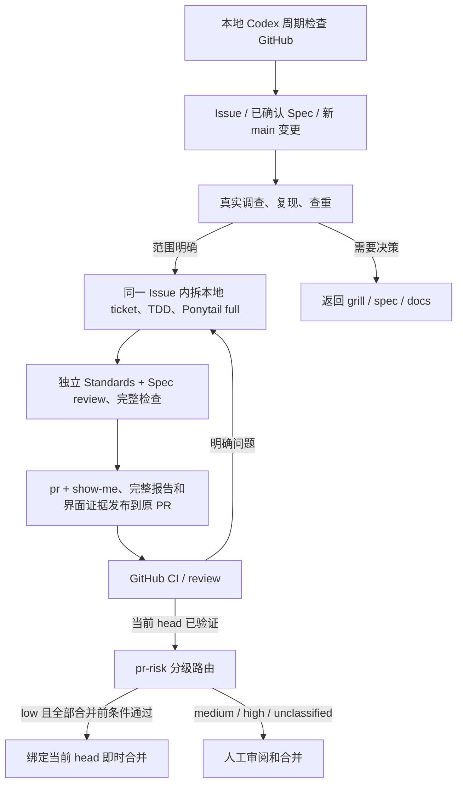

# 本地订阅 Agent 工作流

执行入口为本机 Codex 的 ChatGPT 登录。GitHub 保存 Issue、PR、review 和工程 CI；
调查、实现与反馈修复由 Codex 本地聊天自动化执行，使用订阅内的 Codex 额度并受其限额约束。
执行协议以 [local-agent.md](../../.agents/workflows/local-agent.md) 为准，领域词汇以
`CONTEXT.md` 为准。本次迁移合并后，旧 gh-aw API 执行入口删除，不同时运行两套 Agent。



## 运行方式与计费

机器和 Codex 桌面应用需要保持运行。使用当前聊天的 heartbeat，每五分钟检查一次；
这属于轮询，不承诺 webhook 实时响应。应用离线、订阅限额耗尽或连接器失效时不能执行，
恢复后重新读取 GitHub 状态；不切到付费 API，不把失败报告为没有任务。

本机已验证 `codex login status` 返回 `Logged in using ChatGPT`。检查命令：

```bash
bun run agents:check        # 检查协议、skills 和仓库中是否残留托管 API 执行入口
bun run agents:local-check  # 另检查本机 ChatGPT CLI 登录及 API-key 环境变量
bun test tests/agent-issue.test.ts tests/pr-feedback.test.ts tests/defect-scan.test.ts
```

GitHub CI 的本地协议检查只执行第一个命令，不需要本机登录或 OpenAI API key。
证据 publisher 使用 Actions 自带的 GitHub token，不要求另配发布 PAT。
`agents:check` 只验证仓库执行契约，不能证明调度器已启用或某个任务已经完成。
本地登录检查也不证明还有多少剩余额度，实际限额错误仍需保留。

GitHub 操作优先使用本地 Codex 已连接的 GitHub 工具；已登录的 Git client 也可使用。
不要求复制连接器凭据或创建 `AGENT_PR_TOKEN`。个人 `auth.json`、订阅登录文件和 API key
都不能上传到 GitHub；本方案不安装公开仓库的 self-hosted Actions runner。
官方说明见 [认证](https://learn.chatgpt.com/docs/auth#openai-authentication)、
[自动化认证](https://learn.chatgpt.com/docs/non-interactive-mode#authenticate-in-automation)和
[本地聊天定时任务](https://learn.chatgpt.com/docs/automations#schedule-a-task-inside-a-chat)。

## 自主执行范围

用户参与前期 grill、spec、领域文档和公共测试 seam；最终审阅和合并按
[pr-risk](../../.agents/skills/pr-risk/SKILL.md) 分级路由。
确认后，Agent 自主拆分、审计划、实现、测试、独立 review 和修正，不逐票询问。
需求、公开契约、ADR 或安全策略发生变化时返回前期讨论。

实现采用 `ponytail` full：读真实调用链，优先复用，做最小充分修复。
Standards 同时应用 `ponytail-review`，Spec 独立核对原始要求。不能因精简而删除必要的
错误处理、公共 seam 或 ADR 约束。使用同一份包含新文件的完整 patch，记录 base、tree、
patch digest、命令与结果。修正后复验，详细轨迹保留在运行记录中。

风险评估由这两轴各自完成，记录具体影响、依据和回滚方案，不新增第三轮审查。
`pr-risk` 是唯一分级规则入口：最终等级取两轴与路径最低等级中的最高值；low 才可能
免人工即时合并，medium 重点人工审阅，high 或历史未分级记录完整人工审阅。
分级和合并策略自身的修改属于 high，不能使用新豁免自行合入。

可见 Canvas 变更与场景维护使用项目 [verify-nodebraid](../../.agents/skills/verify-nodebraid/SKILL.md)。
完整审查报告、行为证据与真实截图/录屏通过 [PR 证据流程](./pr-evidence.md) 发布到当前 head。
该流程沿用现有订阅执行与 GitHub CI，不增加模型 API 或调度器。

开发循环按影响范围执行检查：

```bash
bun run check:affected             # 默认比较 HEAD，包含暂存、未暂存和未跟踪文件
bun run check:affected --base main # 同时检查相对 main 的分支差异
bun run check:affected --plan      # 只展示检查范围，不执行
```

定向通过不代表完成交付。实现或反馈修复先做定向检查，再完成双轴 review，最后由
`agents:run verify` 执行本次交付验证的全量检查；不要在它之前人工预跑同一套
`bun run check`。GitHub CI 仍执行全量检查。

Issue 标签路由见 [issue-tracker.md](./issue-tracker.md)。只有实际复现且预期已明确的缺陷，
或已确认的 spec 可以实现；风格问题、缺少测试、新需求和不明确的预期不能冒充 bug。
GitHub Issue 保存规格、讨论和交付状态；本地 run 保存该需求的实施 ticket、完成证据和
去重元数据。只读 Issue 归档与 ticket 执行记录各有用途，不能从旧副本推断实时执行资格。

新需求使用一个 spec Issue 和一个目标为 main 的 PR。托管 PR 使用 `feat/issue-N` 与
`[local-agent] ` 标题；也接管既有 `[agent] ` issue PR。
移除前缀、关闭 PR 或转为 draft 后不再自动处理。每次写入前重新检查当前资格和 head；
不得复用旧 head 的绿灯。新 review、编辑或已解决 thread 的新回复都需重新判断。
人类 `changes requested` 和争议 thread 不自动 dismiss／approve；需要人工批准时明确等待。
low 候选仍须实际核对当前 head 的报告发布回读、全部合并前 ticket/验收和最新完整讨论，
没有暂停、未决讨论、changes requested 或所需人工批准后，才能使用 expected-head 即时合并。
工具不能约束预期 head 时明确等待，不开启 GitHub auto-merge 队列、不绕过 checks、
不代替 reviewer 批准。medium/high 继续由用户最终审阅合并，已有单 PR 明确授权仍适用。
低风险豁免不授权关闭 Issue；关闭继续按独立授权和完整验收处理。

规格标题统一为 `spec: `，但标题不参与执行授权。设计和验收确认、实施获准后，同一
Issue 标记 `approved-spec` 与 `ready-for-agent`，直接成为交付任务。`to-tickets` 把
内部切片写入本地 run 的计划，不再发布子 Issue、原生 ticket 依赖或叠加 PR。
每次恢复核对批准范围、现有 PR、负责人、外部需求依赖、执行 opt-out、本地计划和剩余验收；
保留仅本地执行、暂停和其他活跃负责人的任务。

本地 ticket 复用 `input.json.plan`、不可改写的 `prepared-task.json.plan`、
`completed-steps.json` 与原始运行证据；计划和可选阅读说明都保存在 worktree 外的同一 run。
`frontier <run-dir> <completed-steps.json>` 推进本地依赖。多个 ticket、提交和 Agent
协作汇入同一个 PR，PR 直接关联 spec Issue。存在合并后验收时使用 `Refs #N`，
验收后按既有权限显式关闭；只有合并是最后剩余条件且关闭已获授权时才使用 `Fixes #N`。
按 Issue tracker 的关闭规则核对提交消息及 Development 的自动关闭关联，避免提前关闭。
ready 表示可供合并前审阅：协调者核对全部合并前 ticket/验收，以及当前 head 的检查、
审查和报告。只能在合并后执行的步骤须在保存的 acceptance 和交接中写明前置条件，
继续保持未完成；ready 不要求提前完成这些步骤或先进入 main。
关闭 Issue 时再要求实际 main 集成、本地 frontier 为空和所有剩余验收证据。
步骤须在实际执行后才标完成，不能为了启动 verify 提前勾完。frontier 仅表示依赖候选，
执行前还须核对外部条件和权限。现有 verify/reconcile 不读取本地完成列表，
不能把上述协调检查描述成自动门禁。

旧父子 Issue、叠加 PR 和 `feat/issue-N-integration` 保留为历史恢复能力，不批量改写。
旧叠加 PR 全部检查通过也只到 `needs-integration`；上游进入 main 后，按原链继续集成、
retarget 和复验。历史父规格仍核对已有子任务及验收。任何源 Issue 都须在实际 main 集成、
完整验收和已有关闭授权满足后收尾，并读回结果。

发布为 append-only，GitHub Git-data API 路径必须核对远端 tree 与已审阅 tree 一致，
使用 expected head 更新分支，不 force push。API 生成的 commit SHA 与本地 SHA 可能不同，
receipt 记录实际远端 SHA。当前 head 的 `Checks / checks`、其他已报告 CI、mergeability、
未解决反馈与有效处置共同决定能否交付给用户。未关闭 thread 的处置必须在当前 head 复核。
合并可信 main 和机械冲突修复也需测试与 review；设计或策略冲突不能擅自决定。

## 主动调查和持久证据

本地检查发现 main 有新变更时，调查自上次完整调查的 SHA 起的变更及受影响公共 seam。
首次没有基线，明确记录当前 snapshot 与实际检查区域，不虚构历史覆盖率。
在干净的、已 fetch 的 main worktree 中生成范围：

```bash
bun run agents:scan                    # 第一次 snapshot 调查
bun run agents:scan <last-reviewed-sha> # 后续完整变更范围
```

该命令写入忽略的 `.tmp/agent-defect-scan.json`。调查后按根因、症状和公共接口查重，
新 Issue 包含真实可运行复现、命令退出状态、base/head、预期契约、实际行为与验收条件。
调查失败或 Issue 未实际发布时不推进基线；没有新发现不等于全仓无缺陷。
全局 SHA 只表示变更调查位置。另用 `discovery.json` 保存公共 seam 的待办；首次迁移
显式 `init`，保守地将所有现存 package、workflow、docs 和 examples 标为 pending，
已执行的调查再以原始证据逐项完成。`sync` 保留未完成和已删除 package 的调查记录，
只有受影响的已完成 seam 会重新排队。没有新提交也继续 pending seam，不重复完整构建。

本机状态存放在 `$CODEX_HOME/local-workflows/nodebraid/`，包含 checkpoint、反馈摘要、
当前 PR head 和不可混同的阶段证据。不得存密钥。损坏状态直接报错；首次创建明确初始化。
原始工具结果与 GitHub 链接保留，不把成功注册调度、一次检查通过或本地 commit 当成整个闭环成功。

需求/spec 及其实现任务的本地副本保存在同级 `issues/<number>/`：`current.md` 方便阅读，
`current.json` 保留原始字段，`history/<content-hash>.md/.json` 保留不同版本。GitHub 仍是事实源；
本地副本不回写、不参与资格判断，不提交到源码仓库，也不随 worktree 清理。每次按既有讨论边界
完整读取 GitHub 或写入后回读成功，执行 `agents:run archive-issue`；无需新增定时任务。
相同内容不重复归档，关闭 Issue 的副本继续保留。输入与失败处理见
[本地副本约定](./issue-tracker.md#local-reading-and-archive-copies)。

## 执行命令和恢复

执行使用版本管理的 `scripts/local-agent.ts`，不再调用忽略目录中的临时验收脚本。
每次 Issue 或 PR 反馈请求有独立 run 目录，通常放在上述本机 `runs/<run-id>/`。

```bash
bun run agents:run archive-issue snapshot.json ~/.codex/local-workflows/nodebraid/issues
bun run agents:run normalize raw-github.json published-feedback.json snapshot.json
bun run agents:run reconcile reconciliation-source.json reconciliation.json
bun run agents:run prepare task-input.json /absolute/path/to/run
bun run agents:run frontier /absolute/path/to/run completed-steps.json
bun run agents:run inspect /absolute/path/to/run
bun run agents:run verify /absolute/path/to/run reviews.json decisions.json
bun run agents:run publication /absolute/path/to/run actual-remote-commit.json
bun run agents:run evaluate /absolute/path/to/run snapshot.json
```

`task-input.json` 的字段为 `run`、`repository`、`source: {kind: issue|pr, number}`、
`branch`、当前 PR 目标分支 `baseRefName`、完整 SHA `base`、完整 SHA `expectedParent`、
原始请求摘要 `request`、待处理反馈 `pending`，以及 `plan: [{id, blockedBy, acceptance}]`。
`base` 是目标分支本次读取的提交，作为 review、完整 binary patch、验证、preview 与 report 的共同审查起点。
`expectedParent` 是本轮发布必须追加的远端源分支 head；新分支尚不存在时使用刚 fetch 的目标提交。
初次发布二者通常相同，追加修复和同步 main 时可以不同；必须在执行前从独立来源保存，
不能从发布响应倒推，也不能用其中一个代替另一个。本地验证提交必须包含二者的祖先历史。
原 Issue/spec revision 和用户已确认的验收条件随输入一起归档。
新 `prepare`、`verify`、`publication` 和 report 都要求 `expectedParent`；prepare/verify 仍要求 `baseRefName`。
旧记录保持原 digest 和已发布产物，可读取供历史审计，但缺少任一独立字段时 `evaluate` 返回
`waiting-verification`，当前执行器不会为其补值、复验、发布或重生成报告；必须另建 run。
PR retarget 或目标 SHA 改变后，即使 head 未变也要绑定新 base，重做 review 与完整验证。
`pending` 来自完整归一化快照的 `evaluateFeedback` 结果。依赖图必须无环且引用存在，
`completed-steps.json` 是已有执行证据的已完成 step ID 数组，不能越过未完成 blocker。
这些 step 就是本地 ticket；Issue 编号不作为内部 ticket ID。
`input.json` 是准备前的草稿，prepare 后以 `prepared-task.json.plan` 为执行依据。
改变计划或请求时新建 run，保留旧记录，并根据实际证据重新评估可复用的完成项。
需求、验收和讨论仍在同一个 GitHub Issue；本地 ticket 不发布成新的 Issue 或 PR。

`reconcile` 是只读对账命令，不调用 GitHub 写入、不 merge、不关闭 Issue；可选第二个
参数保存报告。它读取完整独立来源，契约为
[`ReconciliationInput`](../../scripts/local-agent-reconcile.ts)，不能从上一份成功报告倒推输入：

- `repository: {full_name, default_branch}` 来自仓库元数据；`main` 为刚 fetch 的
  `refs/remotes/origin/<default_branch>` SHA。命令要求该 ref 与 SHA 一致，并对每个
  merged PR 的真实 `merge_commit_sha` 执行 Git 祖先检查；提交缺失或 Git 错误直接失败。
- `actor` 为当前 GitHub 用户，`executor` 为当前执行聊天身份。`closeAuthorization`
  记录已有用户关闭授权的来源，没有授权填空字符串；它不代表合并权限。
- 新需求使用 `specs: []`，每个单一交付 Issue 只在 `tasks` 中出现一次，`parent: null`。
  这里的 `tasks` 指 GitHub 交付，不是本地 plan 的 ticket。`blockers` 只装真实外部
  Issue 依赖的完整 REST 分页，无依赖时为 `[[]]`，不填本地 step ID。
- 每个条目保留完整 `issue`（正文、评论、标签、assignees、规范化的
  `OPEN|CLOSED` 状态），以及从真实讨论确认的 `approval` 来源链接或 null、
  `execution: agent|local-only|paused`、当前执行 `owner` 或 null、
  全部 `acceptance: [{id, evidence}]`。未完成证据为 null，不能省略尚未完成的条件。
- `specs` 聚合仅用于既有父子 Issue 的历史对账。此时 spec 的 `children`、task 的
  `blockers` 是真实 REST 分页数组，元素含 issue
  `number`，通过最后一个少于 100 条的页面（空集合为 `[[]]`）。spec 的
  `slices: [{id, task}]` 覆盖完整已批准范围，未拆分项的 task 为 null；task 的
  `parent` 是父 issue number 或 null。声明的切片、父子关联与原生关系必须一致。
- 新任务的 `pullRequests` 复用该需求的唯一 PR，创建前为空；`delivery` 是该 PR number
  或 null。历史条目保留全部已有 PR number 和选定的最终 delivery，不能丢失原链。
  顶层 `pullRequests` 保留这些 PR 和历史依赖上游 PR 的实时
  `number/title/state/draft/head/base/merged/merge_commit_sha/html_url` 元数据；
  每个 `base.repo.full_name` 必须是当前仓库，包括已 merged 的 PR；
  后续集成不能丢弃原始 PR 链。后续 PR 可以复用旧实现 head 而不包含旧功能分支的
  merge commit；此时将新 PR 选为 task 的 `delivery`，按它与验收判断任务完成。

报告包含 GitHub 交付 `frontier`、按当前任务 `delivery` 得出的 `integration` 候选、
PR 集成状态、历史聚合规格的标题/未完成子任务、未完成验收和
关闭候选 `canClose`。证据字段是来源引用，helper 不读取或认证 URL 内容，
非空字符串本身不能证明当前 CI、反馈、独立 review 或全量检查通过。执行者必须复用
已有真实 `verify`、`publication`、报告发布/回读和 `evaluate` 结果核实对应交付 head，
再把真实证据引用填入每项验收。候选不是执行授权或完成证书。
执行者还须确认整个 spec 和本地 tickets 的证据完整，维护同一 PR 的反馈，并在每次
授权写入前刷新来源和 main。对于旧父子记录，关闭已有子任务并回读后再次对账，才可
评估父规格关闭。历史关系缺失、依赖循环和不完整分页
明确失败。规范改名、拆票完成或单次绿色检查不等于完成交付。
历史 PR 的 `needs-integration` 不是待执行队列；已选定的后续 delivery 进入 main
且验收通过后，`integration` 不再包含该任务，不因旧 merge commit 缺席而重复恢复。

`prepare` 独立写入 `prepared-task.json`，重启后相同输入可恢复，变更输入需要新 run；
不能从结果 receipt 复制一个“预期 task”。`inspect` 输出当前完整 head、tree 和原始
`git diff --binary <base> HEAD` 的 SHA-256，两个 reviewer 以同一组值审查完整 patch。
`reviews.json` 是 `{standards, spec}`，每轴包含 `head`、`tree`、`patch`、实际 `report`、
明确的 `verdict: passed|changes-requested|needs-design` 和
`risk: {level: low|medium|high, rationale, evidence, rollback}`；后三项均为非空字符串。
仅两轴均 passed 且分级完整可启动新的验证发布。`verify` 从真实 Git diff 捕获
`changedFiles`，应用 `pr-risk` 的路径最低等级；路径仅能提高风险，不证明 low。
风险和变更路径随既有 head/tree/patch 身份保存，完整报告保留两轴依据及最终路由。
`decisions.json` 必须恰好覆盖原 pending 的 key/digest、处置和原因。

`verify` 是托管交付全量检查的唯一入口，在干净提交上运行真实 `bun run check`，收据中的
命令保持 `bun run check`。每次尝试保留唯一日志，并检查运行前后 source 没变。失败结果
保存在 `verification.json`，原始日志不覆盖；重启后可以复验。同一 head 的新尝试也会
重新执行真实进程，不缓存或跳过检查。`publication` 读取 GitHub Git commit 原始返回值
`{sha, tree: {sha}, parents: [{sha}]}`，核对远端 tree 与已检查 tree，且第一父提交必须是
独立保存的 `expectedParent`；不能仅在后续 merge parent 中找到它或拿审查 `base` 代替。
实际远端父提交中还必须至少有一个包含审查 `base` 的祖先历史；同步 main 时不能丢掉
保留这段历史的额外父提交。发布前须使这些父提交对象在本地可读；Git 读取错误直接失败。
API 生成的远端 SHA 可以不同，但一份 run 不得绑定第二次发布。先记录发布再调整本地 ref。

证据命令为 `agents:preview --base <sha> --out <empty-dir> [--all]`、
`agents:report <run-dir> <output-dir>` 与
`agents:publish-evidence prepare <output-dir> <repository> <pr> <head>`。
preview 的 `--base` 使用 prepared task 的审查 `base`，report 另记录已验证的 `expectedParent`。
先采集 preview，再将 report 生成到同一目录；report 只创建新文件。`prepare` 只生成连接器
发布计划；已有 `GITHUB_TOKEN` / `GITHUB_REPOSITORY` 的环境可直接执行
`agents:publish-evidence <output-dir> <pr> <head>`。参数、行为证据 schema、连接器操作和
CI 权限边界见 [PR 证据](./pr-evidence.md)。

`normalize` 的完整输入契约为 `scripts/github-feedback.ts` 的 `GitHubFeedback`：
PR 的 `base.sha` 必须是真实目标 SHA，归一化为 `baseRefOid`；缺失或无效时明确失败。
`comments`、`reviews` 为每页 100 条的 REST page 数组，包含最后短页（恰好 100 条时
还要读空页）；`threads` 包含外层页和已读完 cursor 的评论；CI arrays 匹配报告总数。
实际 workflow 的 head/path/name 用于识别项目 Checks，workflow 自身的 pending/failure
也保留，不能只挑成功的 job。combined-status 响应的原始 `sha` 也必须核对当前 head。
普通 COMMENTED 不能清除同一人的 changes requested，只有其后正式批准或 dismiss
才更新有效决定。`published-feedback.json` 仅含已发布且 key/digest 精确
匹配的自己评论。新评论、编辑、resolved thread 的新回复和人类 changes requested
都进入判断。新 head、目标分支名或目标 SHA 改变时返回 `waiting-verification`，
不会把旧 tree、测试和 review 改贴到新 SHA，也不会用已通过的另一审查范围交付。

`evaluate` 保留原 ready/repair/waiting 等状态，追加 `risk: {level, route, reasons}`
和 `autoMergeCandidate`。route 为 low 的 `automatic`、medium 的 `quick-human`、
high 或 unclassified 的 `full-human`；只有 ready 且 low 时自动合并候选为 true。
旧收据缺少风险或变更路径时仍可读取，明确 unclassified 并交人工审阅，不能补写旧证据。
候选不执行合并，也不核对本地 ticket 完成记录。

`evaluate` 尚未自动检查完整报告和媒体的发布回执。每次交付 ready 前，执行者还必须实际
发布并回读当前 head 的报告，记录报告 URL、source head 与 evidence commit；不能把
`evaluate` 的 ready、autoMergeCandidate 或 CI preview 上传成功当成这一步已完成。

调查队列的命令为：

```bash
bun run agents:discovery init /absolute/path/to/discovery.json
bun run agents:discovery sync /absolute/path/to/discovery.json
bun run agents:discovery finish /absolute/path/to/discovery.json report.json
```

命令在已 fetch 的干净 main 上执行。`report.json` 含 `seam`（如 `packages/kernel`）、
`head`、`evidence`、`remaining: [剩余公共接口的唯一名称]` 和 `commands: [{command, exitCode}]`。命令失败、报告缺失或过期不会
清掉 pending；原始命令输出、查重和 Issue 发布结果仍随报告归档。成功报告保存成不可变
evidence 文件再原子更新队列；相同报告恢复不会重复完成任务。一次完成只代表报告中实际
调查的公共接口，仍未检查的部分必须在 `remaining` 中拆成剩余待办（全部完成时显式 `[]`），不能用一行概述声称整个 package 已覆盖。

## GitHub 合并门禁

配置默认分支时使用独立的 `main-pr-and-checks` ruleset：required PR、由 GitHub Actions 上报的
`checks`、最新 main、讨论解决和非快进/删除保护。单人维护时 approving review count
为 0，避免作者无法批准自己的 PR；分级路由不修改该设置，也不能绕过实际所需的批准。
原 disabled `deny`
规则含限制所有更新等其他策略，不能直接启用代替上述配置。
可审查的请求正文保存在 `docs/agents/main-ruleset.json`；它只是配置输入，不代表远端已启用。

只有读回 active rules 及默认分支后才能报告生效。管理操作需要已有 GitHub 管理登录，
连接器不能写 rulesets 或认证失效时保留错误；准备好的 JSON 不算已生效。不能通过
关闭 TLS 校验、复制连接器凭据或调用付费模型完成配置。

## 验证与验收状态

开发迭代执行 `bun run check:affected`，按行为增加公共 seam red/green、状态序列、故障注入、
真实 Chromium、声明隔离或 package 消费测试。正式交付仍需全量 `bun run check`，托管任务
由 `agents:run verify` 执行一次，不在此前重复人工执行。具体选择来自任务风险；不宣称每个
包都已拥有属性测试、状态模型或故障注入。禁止弱化断言、假成功和静默 fallback。

首次真实验收使用 [Issue #6](https://github.com/ZWkang/nodebraid/issues/6)：

- 在 `9d2964337e7e1a86d98d02d7ad7397905375087d` 执行 Dagre 公共 seam 复现，exit **1**；
  普通 ID 通过，合法特殊 ID 丢失一条边的布局约束。
- 旧 API triage 运行 [39364597209](https://github.com/ZWkang/nodebraid/actions/runs/39364597209)
  在启动前明确失败：没有 `CODEX_API_KEY`／`OPENAI_API_KEY`。这不计作本地订阅验收。
- 后续本地实现、双轴 review、PR、实际 CI 与反馈修复分别记录其真实结果；不人为破坏
  main 或伪造 review 来补齐验收项目。该次迁移的最终人工合并验收保持原要求，后续交付
  按上述分级路由执行。

本地执行层测试使用隔离 Git 仓库和真实子进程，覆盖检查失败/恢复、task 不可重绑、
新 head、分页和依赖前沿。这些 fixture 结果与下一次真实远端 CI/review 修复验收分开记录；
未真实触发的线上分支继续标为 unverified。

新增 `Checks / preview` 在确切 PR head 上采集证据；`workflow_run` publisher 只从受信任
main 执行，并只接受 PR artifact 的 preview 数据。完整独立审查报告通过本地授权路径发布。
新 publisher 合入默认分支后才会触发；未读到真实 run、证据分支和 PR 回读结果前，不报告
远端部署或端到端验收完成。此交付不修改独立 Issue #10 的 GitHub 合并门禁。

在 Codex Scheduled 中关闭这条本地自动化可停止新调度，正在运行的 turn 另行取消。
GitHub CI 不依赖这台机器；已有 GitHub secrets 不被自动删除，但迁移后不再被 AI 工作流使用。
