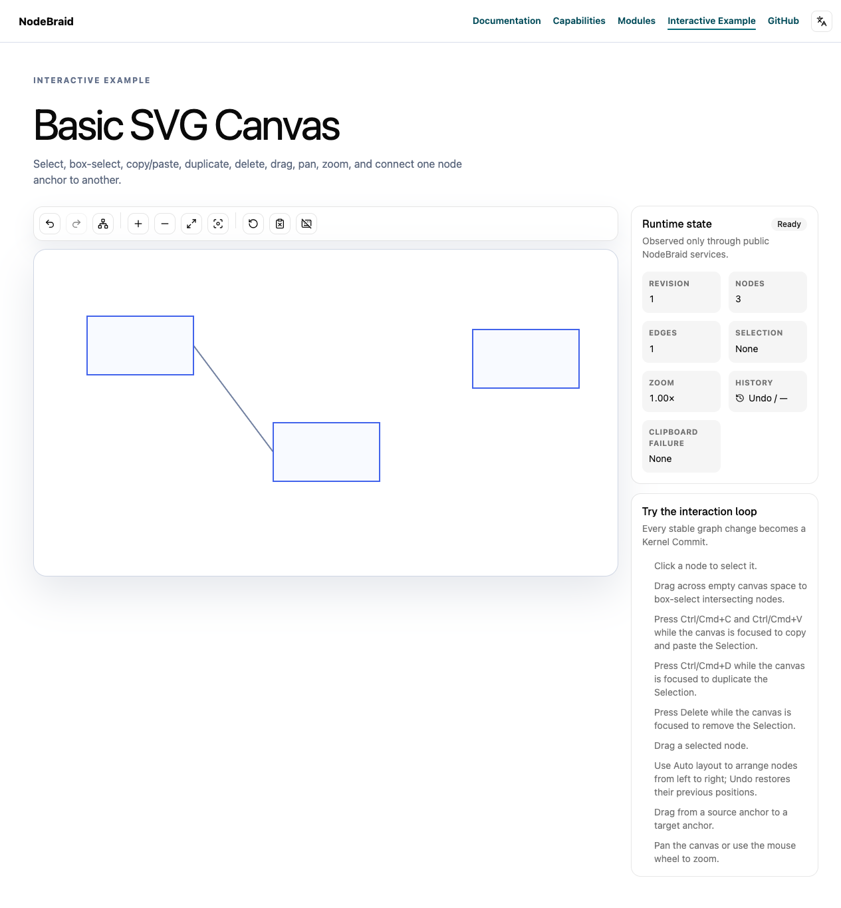
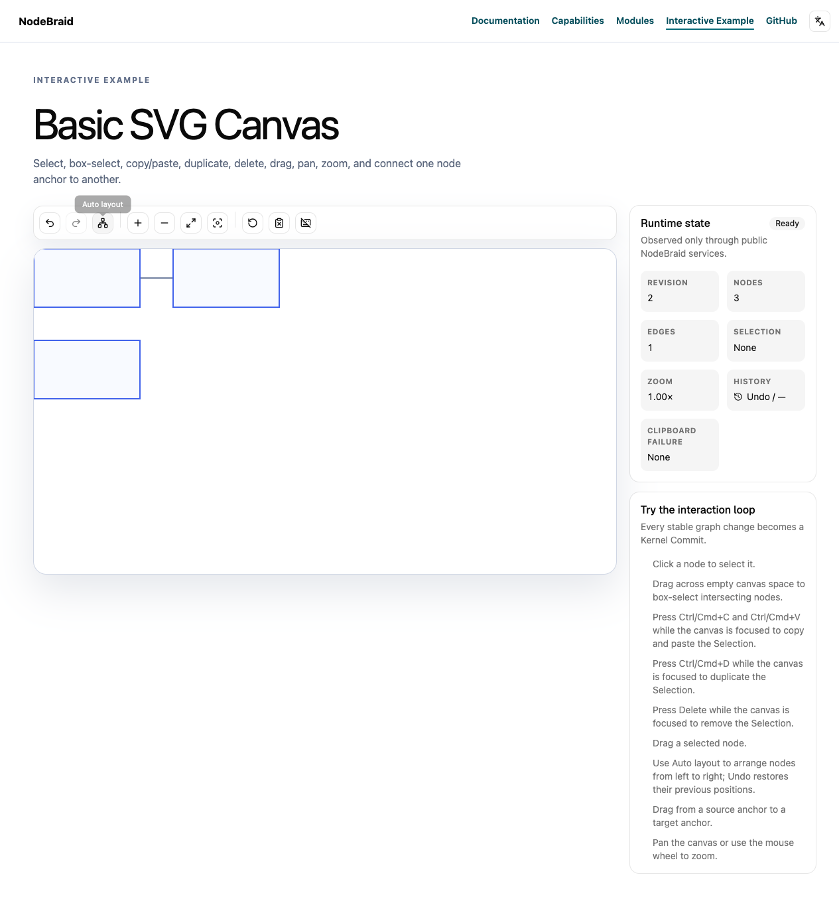

# Verification report

Run: 4882b021-e3e2-4393-8fc6-2cd6f616b323 · ZWkang/nodebraid · issue #88

## Reviewed and published source

- Review base: `8d185d1fe2cdbe53af51bd69f600cfc43552b77e`
- Independently prepared append parent: `4ef7ffe35993bae3e871df72d367678c1eee4bc9`
- Published head: `5d554c9f309b3067b1257eb4896445fd0bafac99`
- Reviewed local head: `94802b787c4b5c91267f574ed6ffcd6ce8a5d97c`
- Tree: `c6410b3c252ab1e98bc2038fcf25334ed8a048a3`
- Complete binary patch SHA-256: `30897c7363497cddaa543f825c64a7a6af564998ce18e2f84082809966616bfe`

The publication record matches the reviewed tree and expected parent. Remote PR freshness is checked separately by the publisher.

## Acceptance plan

## Confirmed defect

On fetched main `1c85d79db1e275e59f84a9bb77d1fe75c0a582e6`, Layout Runtime inspects a directly implemented Engine's resolved Proposal before checking whether the execution was cancelled during computation.

A real compiled public Host/Kernel/Command/Layout probe compares the same Provider function:
- Without cancellation, a direct `LayoutEngine` commits the expected Node position at revision 2.
- When wrapped with `defineLayoutEngine`, cancelling during computation preserves the exact Abort reason and reads no Proposal fields.
- With direct `LayoutEngine` installation, the same cancellation still reads `sourceRevision`. A lazy Proposal getter's error replaces the Abort reason. No layout commit occurs, but the caller receives the wrong failure and cancelled output is inspected.

The public assertion requiring cancellation before Proposal inspection exits 1. Original source/output: local run `20261022T072944-maintenance`, `layout-cancellation-repro.ts` and `layout-cancellation-red.log`. Existing Runtime tests pass (8 tests / 15 assertions).

## Contract and cause

[ADR 0026](https://github.com/ZWkang/nodebraid/blob/1c85d79db1e275e59f84a9bb77d1fe75c0a582e6/docs/adr/0026-validate-layout-contracts-at-their-ownership-boundaries.md) requires cancellation checks around every asynchronous boundary. [ADR 0029](https://github.com/ZWkang/nodebraid/blob/1c85d79db1e275e59f84a9bb77d1fe75c0a582e6/docs/adr/0029-preserve-domain-and-external-error-identity.md) preserves original external errors and Abort reasons. The [Layout Runtime contract](https://github.com/ZWkang/nodebraid/blob/1c85d79db1e275e59f84a9bb77d1fe75c0a582e6/website/en/modules/plugin-layout.md) explicitly supports third-party Engines and checks the signal before and after every asynchronous boundary.

In [layout-plugin.ts](https://github.com/ZWkang/nodebraid/blob/1c85d79db1e275e59f84a9bb77d1fe75c0a582e6/packages/plugin-layout/src/layout-plugin.ts), `await engine.compute(...)` is embedded inside `validateLayoutProposal(...)`. The next Runtime cancellation check happens after validation. Engines using the official helper have an earlier check; directly implemented Engines expose the missing Runtime check.

## Acceptance

- Check the execution signal immediately after a successful Engine computation resolves, before reading or validating its Proposal. Preserve the existing post-validation check, live revision check and single synchronous Transaction.
- Cancelled direct and helper Engines preserve the exact original Abort reason without inspecting resolved Proposal fields or committing.
- Preserve uncancelled direct-Engine success, invalid Proposal rejection, original uncancelled getter errors, original computation rejection, pre-abort behavior, cancellation triggered during validation, stale/concurrent revision protection, metadata, net-zero results and lifecycle cleanup.
- Use the existing public Host/Command/Kernel seam for a red/green regression and relevant controls. Add no API, mandatory helper, accessor ban, wrapping policy, retry, cap or fallback.
- Complete related Layout/Command checks, independent Standards + ponytail-review / Spec, full engineering verification, actual current-head CI and complete report/media publication/readback.
- Keep this Issue open until actual main integration and final acceptance.

## Deduplication

Complete all-state metadata through final short pages (87 Issues/PRs, 45 PRs) found no existing Runtime post-computation cancellation repair. Closed #78 / PR #79 repair accepted Request/Proposal values, including repeated getter reads; #21 concerns disposal-promise publication before Abort reentry. Neither inserts the missing Runtime cancellation check.

### synchronize-main

Capture current fetched main and published source head independently before append-only synchronization of the existing delivery branch. Preserve original Issue scope.

Dependencies: none

### integration-compatibility

Fresh public affected consumers and integration checks pass. Save complete current head/tree/binary patch; historical evidence retains its original source.

Dependencies: synchronize-main

### independent-review

Fresh independent Standards with ponytail-review and Spec inspect the complete current patch against original Issue, ADRs and current main.

Dependencies: integration-compatibility

### formal-engineering-check

Pinned main versioned agents:run verify executes the real full bun run check after both review axes pass; preserve every attempt.

Dependencies: independent-review

### publish-current-head

Actual remote tree and original append parent match verification; current-head CI, complete feedback, immutable full report/media publication and readback pass.

Dependencies: formal-engineering-check

### authorized-merge

Recheck current source/base, strict checks and all feedback immediately before a normal expected-head merge. Preserve review disputes and protection.

Dependencies: publish-current-head

### main-integration-acceptance

Verify actual fetched main ancestry and the whole original Issue through fresh public acceptance; publish outcomes and close only after complete acceptance.

Dependencies: authorized-merge

## Full engineering check

`bun run check` — exit 0; checked source remained unchanged.

[Original command output](logs/full-check.log)

## Standards review

Verdict: passed. [Original report](reviews/standards.md)

What this change does: Layout Runtime checks cancellation after a successful Engine computation and before inspecting its Proposal. It retains the existing cancellation check after validation.

Verdict: passed. Looks good. Ship.

Reviewed identity:

- Base: `8d185d1fe2cdbe53af51bd69f600cfc43552b77e`
- Head: `94802b787c4b5c91267f574ed6ffcd6ce8a5d97c`
- Tree: `c6410b3c252ab1e98bc2038fcf25334ed8a048a3`
- Binary patch SHA256: `30897c7363497cddaa543f825c64a7a6af564998ce18e2f84082809966616bfe`

Hard standards: no violations found. Read the complete two-file patch, all 224 regression-test lines, current project rules and applicable principle guidance. Read Issue #88, its empty discussion/blockers, the independent prepared plan and supplied PR #90 description and empty feedback checkpoint.

The new guard belongs at Runtime’s asynchronous boundary under ADR0026 and Boundary Discipline. It supports direct Engines without requiring the optional helper. Engine rejection still propagates unchanged because the guard runs only after successful resolution. ADR0028/0029 error ownership and identity remain intact. The later guard is necessary when a Proposal getter cancels execution during validation.

Judgment checks: no concrete Fowler smell found. Assuming one isolated Canvas Host with independently cancellable Command executions, this local change adds no shared state or scheduling. The two checks protect different boundaries. Traced Command signal forwarding/disposal, Engine helper, Proposal validation, live revision protection, single Kernel Transaction and History observation. Current Session/Interaction/Composition integration does not change those owners.

Independent checks, after dependency construction completed: `bun test packages/plugin-layout/tests packages/layout-api/tests packages/plugin-command/tests tests/layout-providers.test.ts` passed 73 tests / 261 assertions at this head. They cover direct/helper cancellation with zero Proposal reads, original getter/computation failures, cancellation during validation, stale revisions, normal/net-zero commits and real Dagre/ELK with Undo/Redo.

Verified exact saved patch/hash, prepared-task/inspection binding, published source first parent, captured main second parent, clean worktree and `git diff --check`. Commands/raw output are in `standards-command-log.txt`. Historical results and workflow timeouts were not counted as current-head checks.

Not checked: fresh builds/typecheck, native browser or Auto layout button evidence, full engineering gate, live feedback refresh, new-head remote CI, publication or merge. API tests establish the cancellation contract; ordinary UI scenes do not replace them. This report covers independent Standards and ponytail-review only.

## Spec review

Verdict: passed. [Original report](reviews/spec.md)

verdict: **passed**

独立重审当前完整两文件补丁及 224 行公共回归、原 Issue #88 全文/空讨论/依赖、独立 prepared plan、AGENTS/CONTEXT、tracker/讨论/code-review、ADR0026/0028/0029 和 Engine → Layout Runtime → Command → Kernel/History 调用链。未发现规格遗漏、错误实现或范围扩张。

满足“immediately after a successful Engine computation resolves, before reading or validating its Proposal”：成功 await 后先检查 execution.signal，再调用 validator；post-validation、live revision 与单同步 Transaction 检查保留。直接/helper Engine 取消保留 exact reason、0 Proposal reads、无 commit。await rejection 仍原样传播，包括已 abort；未取消 getter/结构错误、pre-abort、validation-triggered abort、stale/concurrent、metadata、net-zero 及 cleanup 保持。新 main 的 Session/Interaction/Preset 变化未增加 Layout 依赖或改变这些服务契约；无 mandatory helper、新 API、包装策略、accessor ban、cap、retry/fallback。

本轮实际运行 `bun test packages/plugin-layout/tests packages/layout-api/tests packages/plugin-command/tests tests/layout-providers.test.ts`：73 pass、0 fail、261 assertions，含真实 Dagre/ELK/History 组合；`git diff --check` 通过。命令/原始输出在 `spec-review-commands.log`。核对当前 head/tree、完整 patch/inspection、干净源码及 merge parents 4ef7ffe/main8d18，未换绑历史结果。

当前 published 4ef7ffe 的完整 comments/reviews/threads 均空，无新增反馈；本地被审 head 尚未发布。未执行本轮 build、affected、full verify、browser/UI capture、新 head CI/反馈、报告回读或 merge/main 验收。取消语义依据公共 API reason/read/commit 断言，不以普通 Canvas 场景代替。

- base: `8d185d1fe2cdbe53af51bd69f600cfc43552b77e`
- head: `94802b787c4b5c91267f574ed6ffcd6ce8a5d97c`
- tree: `c6410b3c252ab1e98bc2038fcf25334ed8a048a3`
- binary patch SHA256: `30897c7363497cddaa543f825c64a7a6af564998ce18e2f84082809966616bfe`

## Behavior evidence

### public-integration

green — passed; exit 0; expected exit 0.

Fresh Layout API/Runtime, Dagre/ELK Providers, Command/Kernel/History and root composition public tests passed119 tests /414 assertions at current head. Direct/helper cancellation preserves exact original Abort reason with no Proposal reads/commit; uncancelled controls retain behavior.

Command: `bun test packages/layout-api/tests packages/plugin-layout/tests packages/layout-dagre/tests packages/layout-elk/tests packages/plugin-command/tests packages/plugin-kernel/tests packages/plugin-history/tests tests/layout-providers.test.ts`

[Original command output](logs/behavior-1.log)

### affected-integration

check — passed; exit 0; expected exit 0.

Actual affected checks for newly integrated Session/Interaction/Composition/docs include relevant consumers, real browser suites and documentation. These general browser scenes do not establish cancellation or manual Layout media.

Command: `bun run check:affected --base 4ef7ffe35993bae3e871df72d367678c1eee4bc9`

[Original command output](logs/behavior-2.log)

### actual-native-layout

green — passed; exit 0; expected exit 0.

At the actual published head, the real production Example receives native Auto layout clicks. Node positions change once; Edge IDs and Viewport remain; repeated layout is net-zero and native Undo/Redo restores observed states. Separate PNG/DOM/actions capture supplements ordinary Layout behavior and does not prove cancellation.

Command: `bun run /Users/zhou/.codex/local-workflows/nodebraid/runs/4882b021-e3e2-4393-8fc6-2cd6f616b323/capture-layout-native.ts`

[Original command output](logs/behavior-3.log)

## Feedback dispositions

No feedback dispositions were included in this run.

## Scope and limitations

The two original review reports above retain their scope, evidence and untested areas. Their separate fields do not authenticate reviewer identity or prove independence.

Only explicitly recorded commands and reports are included. Missing behavior evidence, browser coverage or platform checks are not inferred to have passed.

A red result records the supplied behavior explanation and expected nonzero exit. The original output must still be reviewed to distinguish a behavior assertion from a compile, setup or infrastructure failure.

## Separate native Auto layout capture

Captured at published head `5d554c9f309b3067b1257eb4896445fd0bafac99` using the real production Example and the versioned isolated agent-browser runner. Native Auto layout changes Node positions once, preserves Edge IDs and Viewport, repeats as a net-zero result, and supports Undo/Redo. [Source and observed DOM state](layout-native/source.json) · [Original native actions](layout-native/actions.log). This ordinary Layout UI capture does not exercise cancellation; cancellation is established by the public API regressions above. These PNGs are additional review artifacts; the four trusted CI preview scenes retain their original manifest and bytes.

**Before interaction at this head**

**After interaction at this head**

