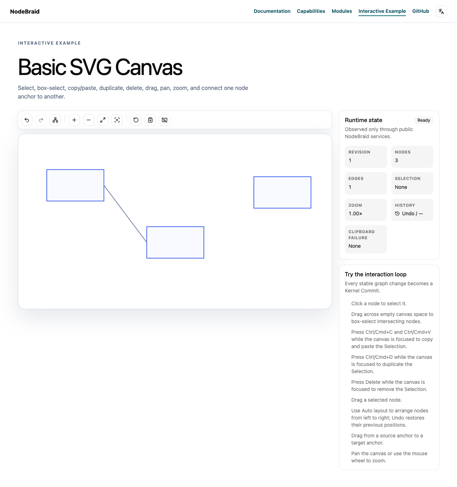
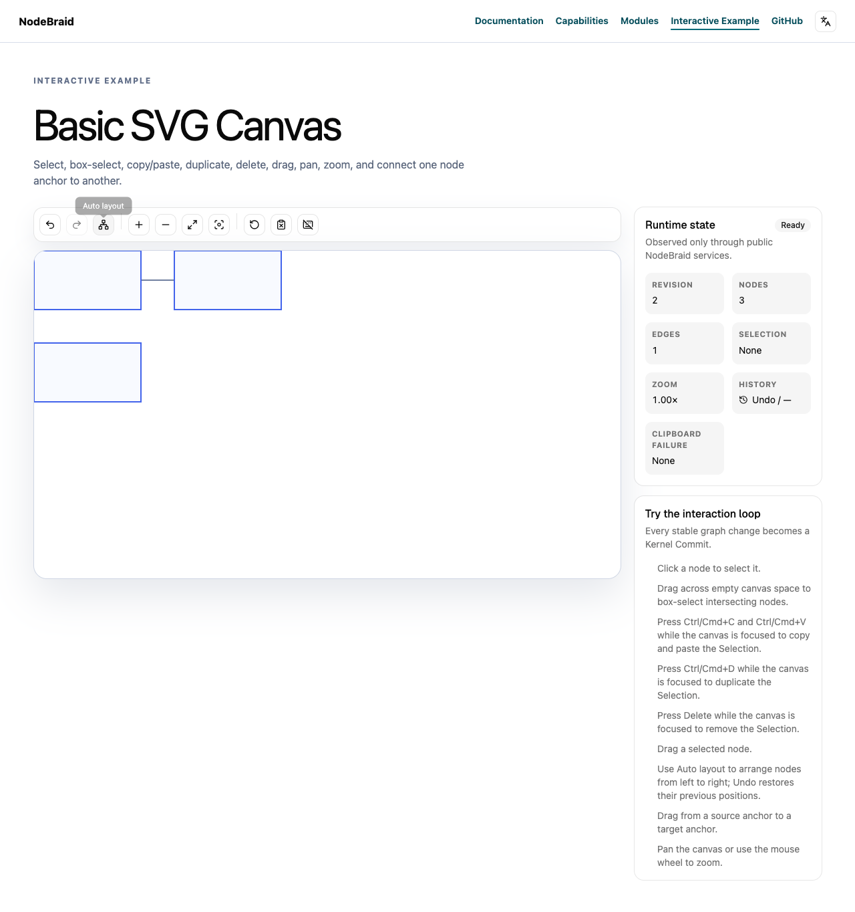

# Verification report

Run: bfe611cd-4043-4a36-9b90-5da911fc283a · ZWkang/nodebraid · issue #98

## Reviewed and published source

- Review base: `efc9a639f967718ef2e8c199e07d7ba49629a057`
- Independently prepared append parent: `cca4e7f6e7f850799387896162aedc89610631ea`
- Published head: `b605fa65b3b8e78c98c9ef9aba8931b9e6ca0d04`
- Reviewed local head: `b605fa65b3b8e78c98c9ef9aba8931b9e6ca0d04`
- Tree: `f5d6e555c7fad38e2ae589234be80e3201db6415`
- Complete binary patch SHA-256: `50f0622fe0fe29d74744f01660840841c10ff8d59ccc7fa34fd8d42c0131dc69`

The publication record matches the reviewed tree and expected parent. Remote PR freshness is checked separately by the publisher.

## Acceptance plan

## Confirmed defect

On fetched main `dcf13482b68bc2422fc4d714df1226ab0ef259aa`, `createLayoutPlugin()` can validate capabilities against one Engine and then compute with a different Engine. A legal readonly `options.engine` getter is read again between those operations.

A fresh compiled public Host/Kernel/Command/Layout probe uses real direct Engine implementations:

- A stable capable Engine computes once and commits `{x:10,y:20}` at revision 2.
- A stable Engine with `incremental:false` rejects an incremental Request with `UNSUPPORTED_FEATURE`; it is never called and revision stays 1.
- The first Engine's capability getter makes the outer options getter return the second Engine on later reads. Runtime accepts the first Engine's `incremental:true`, then invokes the second Engine despite its `incremental:false`. The unsupported Engine computes once and commits `{x:100,y:200}` at revision 2. The Plugin is still named for the first Engine.

Actual changing case:

```json
{"pluginName":"@nodebraid/plugin-layout:first-capable","engineReads":4,"firstCalls":0,"secondCalls":1,"code":null,"revision":2,"position":{"x":100,"y":200}}
```

The public invariant that an unsupported Engine cannot be invoked by a check against another Engine fails with exit 1. No internal Runtime collaborator is mocked. Original source/output are preserved in run `20261023T062254-discovery-layout-binding`: `layout-engine-binding-repro.ts`, `layout-binding-red.log`. Fresh package build and existing Runtime Layout suites pass: **16 tests / 36 assertions**.

## Contract and cause

[ADR0024](https://github.com/ZWkang/nodebraid/blob/dcf13482b68bc2422fc4d714df1226ab0ef259aa/docs/adr/0024-use-provider-specific-layout-commands-without-a-registry.md) binds Provider-specific Commands without a dynamic Registry. The [public Runtime module contract](https://github.com/ZWkang/nodebraid/blob/dcf13482b68bc2422fc4d714df1226ab0ef259aa/website/en/modules/plugin-layout.md) states that the factory statically binds a concrete Engine to a typed Command. [ADR0026](https://github.com/ZWkang/nodebraid/blob/dcf13482b68bc2422fc4d714df1226ab0ef259aa/docs/adr/0026-validate-layout-contracts-at-their-ownership-boundaries.md) and existing public Request tests require unsupported capabilities to fail before Provider execution.

The factory reads `options.engine` for the Plugin name, Runtime diagnostic ID, capability check and computation. Those reads can select different Engine objects, so the guard does not necessarily describe the implementation that runs.

## Acceptance

- Capture the concrete Engine when `createLayoutPlugin()` is called and retain that object for the Plugin name, capability validation and computation throughout its Installations/Activations. Use the same public Engine receiver for `compute()`.
- The changing getter reproduction must keep the first Engine bound: its supported computation runs, the substituted unsupported Engine is not called, and its result is not committed. Ordinary unsupported Engines still reject before execution.
- Preserve direct and helper Engine support; original options-read and computation failures; full/incremental/Fixed Node/self-loop validation; pre/post-computation cancellation; Proposal validation; live-revision stale protection; single-Commit metadata; net-zero and lifecycle behavior.
- Fix the existing shared factory without a Registry, new API, helper requirement, accessor ban, fallback, cap, retry or dependency. Command-token configuration and algorithm implementations remain outside this repair.
- Use the existing public Host/Command/Kernel seam for actual red/green and controls, then relevant Layout/Provider/History consumers, independent Standards with ponytail-review and Spec, formal full engineering verification, exact source publication, current-head CI and complete immutable report/media readback.
- Keep this Issue open until actual main integration and whole-Issue acceptance; delivery remains for human review/merge.

## Deduplication

Complete all-state metadata/body pages contain **97 Issue/PR records and 50 PRs**. Read the full relevant #78, #88, #37 and #15 bodies/discussions. #78 owns Request/Proposal value capture; #88 owns post-computation cancellation; #37 owns Port topology and manual layout; #15 owns ELK seed normalization. None repairs Runtime Engine-object binding between capability validation and computation.

### synchronize-main

Capture current fetched main and published source head independently before append-only synchronization of the existing delivery branch. Preserve original Issue scope.

Dependencies: none

### integration-compatibility

Fresh public affected consumers and integration checks pass. Save complete current head/tree/binary patch; historical evidence retains its original source.

Dependencies: synchronize-main

### independent-review

Fresh independent Standards with ponytail-review and Spec inspect the complete current patch against original Issue, ADRs and current main.

Dependencies: integration-compatibility

### formal-engineering-check

Pinned main versioned agents:run verify executes the real full bun run check after both review axes pass; preserve every attempt.

Dependencies: independent-review

### publish-current-head

Actual remote tree and original append parent match verification; current-head CI, complete feedback, immutable full report/media publication and readback pass.

Dependencies: formal-engineering-check

### authorized-merge

Recheck current source/base, strict checks and all feedback immediately before a normal expected-head merge. Preserve review disputes and protection.

Dependencies: publish-current-head

### main-integration-acceptance

Verify actual fetched main ancestry and the whole original Issue through fresh public acceptance; publish outcomes and close only after complete acceptance.

Dependencies: authorized-merge

## Full engineering check

`bun run check` — exit 0; checked source remained unchanged.

[Original command output](logs/full-check.log)

## Standards review

Verdict: passed. [Original report](reviews/standards.md)

What this change does: Layout binds one concrete Engine when its Plugin is created. The name, capability checks and computation keep using that Engine, including after dependency recovery.

Source identity:
- Base: efc9a639f967718ef2e8c199e07d7ba49629a057
- Head: b605fa65b3b8e78c98c9ef9aba8931b9e6ca0d04
- Tree: f5d6e555c7fad38e2ae589234be80e3201db6415
- Binary patch SHA256: 50f0622fe0fe29d74744f01660840841c10ff8d59ccc7fa34fd8d42c0131dc69

Scope: the complete base...head diff, both files and all 140 new test lines. Commits are cca4e7f and synchronization b605fa6. Both merge parents and prepared/inspection identities agree. `complete.patch` matches canonical `git diff --binary BASE HEAD` byte for byte. `complete-full-index.patch` preserves `git diff --binary --full-index BASE HEAD`, with SHA256 a828316f647642fae44ad6c40347533db417be39855496e53e683605b64c876f. I read Issue #98 and its complete one-comment discussion, including the async-fixture correction.

Hard standards: No violations found. ADR0024 and the public Runtime contract require a statically bound Engine. Capturing the object once establishes that identity without changing Command configuration or Engine internals. ADR0026's Request, capability, cancellation, Proposal and live-revision checks stay at their existing boundaries. Getter and computation failures retain their original values under ADR0029.

Judgment-only smells: No concrete finding across the full Fowler baseline. The local alias fixes the shared factory directly, adds no abstraction or fallback, and keeps the compute method's original receiver.

Ponytail assessment: Looks good for isolated Canvas Hosts with asynchronous computation and synchronous commits. I traced Examples, direct/helper Engines, Dagre/ELK, Command registration/disposal, Kernel commits and History replay. Tests cover both substitution timings, a second Activation, receiver identity and original getter failures.

Independent command at this head:
`bun test packages/layout-api/tests packages/plugin-layout/tests packages/layout-dagre/tests packages/layout-elk/tests packages/plugin-history/tests tests/layout-providers.test.ts`

Result: exit 0; 97 tests, 349 assertions. Final identity, clean-status and whitespace audits passed.

Not checked independently: TypeScript, builds, browsers, full engineering check, remote CI, publication or main integration. Earlier execution evidence was not counted as this review's execution.

Verdict: passed. Looks good. Ship.


## Spec review

Verdict: passed. [Original report](reviews/spec.md)

# Spec review — Issue #98 / PR #99 synchronization

Verdict: **passed**. 未发现需求缺漏、错误实现或范围扩张。

- Base: `efc9a639f967718ef2e8c199e07d7ba49629a057`
- Head: `b605fa65b3b8e78c98c9ef9aba8931b9e6ca0d04`
- Tree: `f5d6e555c7fad38e2ae589234be80e3201db6415`
- Canonical binary patch SHA256: `50f0622fe0fe29d74744f01660840841c10ff8d59ccc7fa34fd8d42c0131dc69`

已独立重读 Issue98 全文及唯一评论6359256086、prepared request/plan、空反馈/依赖记录；完整审阅当前两文件 diff、实际 fix/merge 提交和140行 Engine 回归。评论的 async 接口修正不改变验收；两个直接 Engine fixture 均保持 Promise 契约及原断言。依据当前 AGENTS/CONTEXT、tracker/discussion、code-review、ADR0024/0026/0029 和双语公共 Runtime 文档复核。

Issue 要求 “Capture the concrete Engine when createLayoutPlugin() is called” 并 “Use the same public Engine receiver”。工厂在创建时只读取一次 options.engine；命名、capability validation、compute 及后续 Activation 共享该闭包对象，成员调用保留 receiver。两种替换时机和依赖失去/恢复的公共回归验证实际 Node 位置及调用次数；原始 options getter 异常用 toBe 保留对象身份。能力拒绝仍先于计算，direct/helper 支持、取消、Proposal/live-revision、metadata、net-zero、History 与 registration cleanup 路径未改；没有新增 Registry/API 或扩张 Command/算法范围。

新 main 相对旧基线仅加入 Runtime Binding descriptor 修复；Layout 的普通静态 requires 声明仍沿相同 normalizer 接入，未引入冲突。

独立执行当前 head：`bun test packages/layout-api/tests packages/plugin-layout/tests packages/plugin-history/tests tests/layout-providers.test.ts` **83 pass /320 assertions，exit0**；`git diff --check BASE...HEAD` exit0。`complete.patch` 与 canonical diff 逐字节一致；保留的 `complete-full-index.patch` 与 --full-index diff 逐字节一致，SHA256 `a828316f647642fae44ad6c40347533db417be39855496e53e683605b64c876f`。格式纠正未改变源码；两次测试前 metadata helper 中止及所有原始测试输出已记录于 `spec-commands.log`，不计为产品失败。

未独立执行构建、类型检查、affected、compiled probe、浏览器或完整工程检查；远端发布/current-head CI、完整报告/media、合并与 main 全 Issue 验收未由本审查验证。旧 head 结果未换绑。


## Behavior evidence

### current-integration-tests

check — passed; exit 0; expected exit 0.

Current synchronized b605 actual public Layout API/Plugin/Dagre/ELK/Command/Kernel/History consumers pass122 tests439 assertions.

Command: `bun test packages/plugin-layout/tests packages/layout-api/tests packages/layout-dagre/tests packages/layout-elk/tests packages/plugin-command/tests packages/plugin-kernel/tests packages/plugin-history/tests tests/layout-providers.test.ts`

[Original command output](logs/behavior-1.log)

### current-original-compiled-controls

check — passed; exit 0; expected exit 0.

Current synchronized b605 compiled public Host/Kernel/Command/Layout repeats original three controls; accepted Engine retained, unsupported substitution never invoked. Source differs only by exact head assertion.

Command: `bun run /Users/zhou/.codex/local-workflows/nodebraid/runs/bfe611cd-4043-4a36-9b90-5da911fc283a/compiled-current-repro.ts`

[Original command output](logs/behavior-2.log)

### current-affected-consumers

check — passed; exit 0; expected exit 0.

Actual affected workspace types/public tests, native Example tests and docs at current synchronized b605 complete successfully.

Command: `bun run check:affected --base efc9a639f967718ef2e8c199e07d7ba49629a057`

[Original command output](logs/behavior-3.log)

### current-native-layout

check — passed; exit 0; expected exit 0.

Actual published b605 native Auto layout moves Nodes once, preserves Edge/Viewport, repeats net-zero, and Undo/Redo restores exact before/after state; actual browser and owned server cleanup complete. Does not exercise Engine substitution.

Command: `bun run /Users/zhou/.codex/local-workflows/nodebraid/runs/bfe611cd-4043-4a36-9b90-5da911fc283a/capture-layout-native.ts`

[Original command output](logs/behavior-4.log)


## Feedback dispositions

No feedback dispositions were included in this run.

## Scope and limitations

The two original review reports above retain their scope, evidence and untested areas. Their separate fields do not authenticate reviewer identity or prove independence.

Only explicitly recorded commands and reports are included. Missing behavior evidence, browser coverage or platform checks are not inferred to have passed.

A red result records the supplied behavior explanation and expected nonzero exit. The original output must still be reviewed to distinguish a behavior assertion from a compile, setup or infrastructure failure.

## Native Auto layout at this published head

Actual native Auto layout moves Nodes once, keeps Edge IDs and SVG projection transform, repeats with no extra Commit, and supports Undo/Redo. This ordinary scene supplements the public Engine identity probe.





[Actions and cleanup](layout-native/actions.log) · [Exact source and states](layout-native/source.json)
