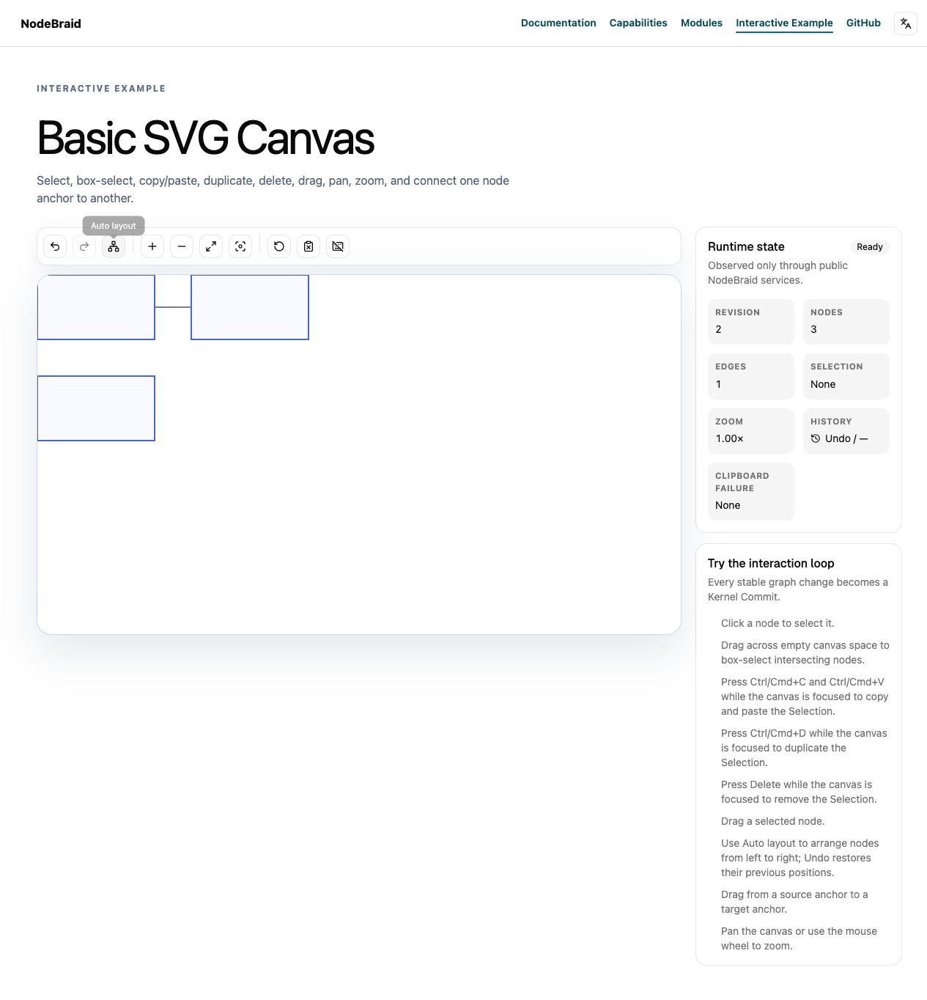

# Verification report

Run: 396bfc5e-12d1-4854-8bb4-0726f49d7476 · ZWkang/nodebraid · issue #98

## Reviewed and published source

- Review base: `dcf13482b68bc2422fc4d714df1226ab0ef259aa`
- Independently prepared append parent: `dcf13482b68bc2422fc4d714df1226ab0ef259aa`
- Published head: `cca4e7f6e7f850799387896162aedc89610631ea`
- Reviewed local head: `cd18e1f097b6fb38cadd432bfa82931029eed58c`
- Tree: `d2d7e8ceefafaec243840ac318ea699b73a92dc9`
- Complete binary patch SHA-256: `50f0622fe0fe29d74744f01660840841c10ff8d59ccc7fa34fd8d42c0131dc69`

The publication record matches the reviewed tree and expected parent. Remote PR freshness is checked separately by the publisher.

## Acceptance plan

## Confirmed defect

On fetched main `dcf13482b68bc2422fc4d714df1226ab0ef259aa`, `createLayoutPlugin()` can validate capabilities against one Engine and then compute with a different Engine. A legal readonly `options.engine` getter is read again between those operations.

A fresh compiled public Host/Kernel/Command/Layout probe uses real direct Engine implementations:

- A stable capable Engine computes once and commits `{x:10,y:20}` at revision 2.
- A stable Engine with `incremental:false` rejects an incremental Request with `UNSUPPORTED_FEATURE`; it is never called and revision stays 1.
- The first Engine's capability getter makes the outer options getter return the second Engine on later reads. Runtime accepts the first Engine's `incremental:true`, then invokes the second Engine despite its `incremental:false`. The unsupported Engine computes once and commits `{x:100,y:200}` at revision 2. The Plugin is still named for the first Engine.

Actual changing case:

```json
{"pluginName":"@nodebraid/plugin-layout:first-capable","engineReads":4,"firstCalls":0,"secondCalls":1,"code":null,"revision":2,"position":{"x":100,"y":200}}
```

The public invariant that an unsupported Engine cannot be invoked by a check against another Engine fails with exit 1. No internal Runtime collaborator is mocked. Original source/output are preserved in run `20261023T062254-discovery-layout-binding`: `layout-engine-binding-repro.ts`, `layout-binding-red.log`. Fresh package build and existing Runtime Layout suites pass: **16 tests / 36 assertions**.

## Contract and cause

[ADR0024](https://github.com/ZWkang/nodebraid/blob/dcf13482b68bc2422fc4d714df1226ab0ef259aa/docs/adr/0024-use-provider-specific-layout-commands-without-a-registry.md) binds Provider-specific Commands without a dynamic Registry. The [public Runtime module contract](https://github.com/ZWkang/nodebraid/blob/dcf13482b68bc2422fc4d714df1226ab0ef259aa/website/en/modules/plugin-layout.md) states that the factory statically binds a concrete Engine to a typed Command. [ADR0026](https://github.com/ZWkang/nodebraid/blob/dcf13482b68bc2422fc4d714df1226ab0ef259aa/docs/adr/0026-validate-layout-contracts-at-their-ownership-boundaries.md) and existing public Request tests require unsupported capabilities to fail before Provider execution.

The factory reads `options.engine` for the Plugin name, Runtime diagnostic ID, capability check and computation. Those reads can select different Engine objects, so the guard does not necessarily describe the implementation that runs.

## Acceptance

- Capture the concrete Engine when `createLayoutPlugin()` is called and retain that object for the Plugin name, capability validation and computation throughout its Installations/Activations. Use the same public Engine receiver for `compute()`.
- The changing getter reproduction must keep the first Engine bound: its supported computation runs, the substituted unsupported Engine is not called, and its result is not committed. Ordinary unsupported Engines still reject before execution.
- Preserve direct and helper Engine support; original options-read and computation failures; full/incremental/Fixed Node/self-loop validation; pre/post-computation cancellation; Proposal validation; live-revision stale protection; single-Commit metadata; net-zero and lifecycle behavior.
- Fix the existing shared factory without a Registry, new API, helper requirement, accessor ban, fallback, cap, retry or dependency. Command-token configuration and algorithm implementations remain outside this repair.
- Use the existing public Host/Command/Kernel seam for actual red/green and controls, then relevant Layout/Provider/History consumers, independent Standards with ponytail-review and Spec, formal full engineering verification, exact source publication, current-head CI and complete immutable report/media readback.
- Keep this Issue open until actual main integration and whole-Issue acceptance; delivery remains for human review/merge.

## Deduplication

Complete all-state metadata/body pages contain **97 Issue/PR records and 50 PRs**. Read the full relevant #78, #88, #37 and #15 bodies/discussions. #78 owns Request/Proposal value capture; #88 owns post-computation cancellation; #37 owns Port topology and manual layout; #15 owns ELK seed normalization. None repairs Runtime Engine-object binding between capability validation and computation.

### public-regression-and-fix

Public Host/Command/Kernel red/green proves the factory retains one concrete Engine through capability validation, computation and reactivation; preserve original errors and valid controls.

Dependencies: none

### affected-consumers

Actual affected Layout/Provider/History consumers, types and related checks pass at the complete current source.

Dependencies: public-regression-and-fix

### independent-review

Independent Standards with ponytail-review and Spec inspect the exact head/tree/binary patch against original Issue and ADRs.

Dependencies: affected-consumers

### formal-engineering-check

Pinned main versioned agents:run verify executes the actual full bun run check after both axes pass and retains original logs.

Dependencies: independent-review

### source-publication

Actual remote source tree and independently prepared first parent match verification; record publication before mapping local branch to any API-created SHA.

Dependencies: formal-engineering-check

### native-layout-evidence

On the actual published source, collect real native Auto layout before/after, repeat/no-op and Undo/Redo evidence with owned browser/server cleanup. These scenes supplement the Engine identity API assertions.

Dependencies: source-publication

### current-head-ci-and-reports

Current-head real CI, full paginated feedback, exact report/preview/native artifacts publication and complete immutable byte readback pass before readiness.

Dependencies: native-layout-evidence

### human-merge

Human review and normal protected main merge.

Dependencies: current-head-ci-and-reports

### main-integration-acceptance

Fetch actual main, verify merge ancestry and fresh whole-Issue public acceptance; keep Issue open until complete.

Dependencies: human-merge

## Full engineering check

`bun run check` — exit 0; checked source remained unchanged.

[Original command output](logs/full-check.log)

## Standards review

Verdict: passed. [Original report](reviews/standards.md)

What this change does: Layout Plugin captures one concrete Engine at creation. Its name, capability checks and computation retain that object, including the compute method receiver across later Activations.

Reviewed identity:

- Base: `dcf13482b68bc2422fc4d714df1226ab0ef259aa`
- Head: `cd18e1f097b6fb38cadd432bfa82931029eed58c`
- Tree: `d2d7e8ceefafaec243840ac318ea699b73a92dc9`
- Binary patch SHA256: `50f0622fe0fe29d74744f01660840841c10ff8d59ccc7fa34fd8d42c0131dc69`

Scope: complete three-dot base-to-head diff, both commits, `packages/plugin-layout/src/layout-plugin.ts` and all 140 lines of `engine-binding.test.ts`. Read the original Issue #98, prepared plan and complete follow-up comment 6359256086. The earlier interrupted review is not treated as a passed review.

Hard standards: no violations found. The factory now reads options.engine once before creating Plugin metadata. The retained reference is used for capability validation and `engine.compute(...)`; the method is not detached. The same reference survives Kernel dependency recovery. Command-token access and Engine internals remain unchanged.

The two direct Engine fixtures now declare async compute, matching `Promise<LayoutProposal>` in the public interface. The correction changes only those two keywords; receiver, call-count, position, reactivation and strict original-error assertions remain. This resolves the fixture conformance problem without weakening the behavioral regression.

Reviewed current project rules/principles and ADR0019/0021/0024/0025/0026/0029. Traced Examples and Provider callers through Engine/helper capability checks, Command cancellation, Proposal validation, Kernel Transaction and History. Cancellation guards, stale protection, metadata, net-zero behavior and cleanup remain intact.

Judgment checks: no concrete Fowler smell found. For per-Canvas Hosts with independently executed Layout Commands, one captured reference is sufficient. No Registry, new interface, dependency, extra validation policy or fallback was added.

Actual independent checks: resolved exact revisions, read full diff/commit list, matched corrected patch bytes/hash and inspection/task binding, checked clean worktree and `git diff --check`. Reviewed supplied conformant red/typecheck records and the green log reporting 19 tests / 61 assertions; these commands were not independently rerun. The earlier synchronous-fixture TS2322 is not counted as successful evidence.

Not checked independently: tests, typecheck/builds, browsers, full gate, current-head CI, publication or merge. The affected check was still running during this review. Earlier results retain their original source identities.

Verdict: passed. Looks good. Ship.


## Spec review

Verdict: passed. [Original report](reviews/spec.md)

# Spec review — Issue #98

Verdict: **passed**. 旧 P2 已完整修正；未发现其余验收遗漏、生产实现错误或范围扩张。

- Base: `dcf13482b68bc2422fc4d714df1226ab0ef259aa`
- Head: `cd18e1f097b6fb38cadd432bfa82931029eed58c`
- Tree: `d2d7e8ceefafaec243840ac318ea699b73a92dc9`
- Complete binary patch SHA256: `50f0622fe0fe29d74744f01660840841c10ff8d59ccc7fa34fd8d42c0131dc69`

已重新独立核验完整两文件补丁、两个提交、inspection/complete.patch、原始 Issue98 和 prepared plan。原始 comments/blockers 为空；新增评论 [6359256086](https://github.com/ZWkang/nodebraid/issues/98#issuecomment-6359256086) 已完整读取，它修正异步接口合规证据，未改变验收。依据当前 AGENTS/CONTEXT、tracker/discussion、code-review、ADR0019/0021/0024/0025/0026/0029、双语 Runtime 文档及 Layout/Command/Kernel/History 调用链审查。

Issue 要求 “Capture the concrete Engine when createLayoutPlugin() is called” 和 “Use the same public Engine receiver”。factory 捕获一次 options.engine，Plugin name、能力校验、计算以及后续 Activation 均闭包引用同一对象；成员调用 engine.compute 保留 receiver。两种外层替换时机均不能选择第二 Engine，既有 unsupported 检查仍位于计算之前。

两个直接 Engine fixture 现为 async compute，符合公开 Promise<LayoutProposal> 契约；第二提交仅增加两个 async，不弱化 this、调用次数、实际 Kernel 位置、一次 getter 读取及第二 Activation 的断言。原 options getter 失败仍通过捕获值后 toBe 验证原对象身份。生产修复与上一审查完全相同；直接/helper 支持、计算异常、full/incremental/Fixed Node/self-loop 验证、取消、Proposal/stale、单 Commit metadata、net-zero 和 cleanup 路径保持。未扩张 options.command、Engine 内部或算法范围，未新增 API、Registry、禁令或 fallback。

实际独立检查：base/head/tree、完整 binary patch/hash 与新保存文件一致；第二提交生产 diff 为空；git diff --check BASE...HEAD exit 0。本轮**未独立执行测试、构建、affected、浏览器或完整检查**。当前 head 发布/CI、native Layout 截图与动作、完整报告/media readback、人工合并及 main 验收未由本审查验证；历史失败和旧 head 结果不换绑。


## Behavior evidence

### promise-conformant-tdd-red

red — passed; exit 1; expected exit 1.

Correct async Engine fixtures typecheck against the exact original production file, then fail the real Engine binding behavior. Original production restored only for this explicit red experiment; fixed bytes restored afterward. This is the definitive valid-interface regression, not the earlier synchronous fixture.

Command: `bun test packages/plugin-layout/tests/engine-binding.test.ts`

[Original command output](logs/behavior-1.log)

### current-connected-layout

green — passed; exit 0; expected exit 0.

Currentcd18 exact source passes122 public tests/439 assertions across Layout API, direct/helper Runtime, real Dagre/ELK, Command/Kernel/History and root Layout composition.

Command: `bun test packages/layout-api/tests packages/plugin-layout/tests packages/layout-dagre/tests packages/layout-elk/tests packages/plugin-command/tests packages/plugin-kernel/tests packages/plugin-history/tests tests/layout-providers.test.ts`

[Original command output](logs/behavior-2.log)

### current-compiled-original-repro

green — passed; exit 0; expected exit 0.

Currentcd18 freshly built public Runtime repeats the original Promise-conformant reproduction with only paths/exact expected head adapted: first Engine called1, substituted Engine0, position10/20; unsupported ordinary control still rejects with no commit.

Command: `bun run /Users/zhou/.codex/local-workflows/nodebraid/runs/396bfc5e-12d1-4854-8bb4-0726f49d7476/compiled-current-repro.ts`

[Original command output](logs/behavior-3.log)

### current-affected-consumers

check — passed; exit 0; expected exit 0.

Currentcd18 actual affected consumer types, tests, native Example browser suites and docs pass after async fixture correction.

Command: `bun run check:affected --base dcf13482b68bc2422fc4d714df1226ab0ef259aa`

[Original command output](logs/behavior-4.log)

### historical-fixture-type-failure

check — failed; exit 1; expected exit 0.

Initial ebd affected attempt failed TS2322 because two new direct Engine fixtures synchronously returned Proposal rather than Promise<LayoutProposal>. The original failure is retained, both methods were corrected to async, and fresh affected/reviews cover the new committed source. This is not a passing check or current-head failure.

Command: `bun run check:affected --base dcf13482b68bc2422fc4d714df1226ab0ef259aa`

[Original command output](logs/behavior-5.log)

### native-layout-published-source

check — passed; exit 0; expected exit 0.

Actual published cca4 source: real production App, native Auto layout changes Node positions once, preserves actual SVG projection transform and Edge IDs, repeats net-zero, and Undo/Redo restores before/after states. Browser/server cleanup completed. This ordinary scene supplements Engine identity API assertions; it does not exercise getter substitution.

Command: `bun run example:build && bun run /Users/zhou/.codex/local-workflows/nodebraid/runs/396bfc5e-12d1-4854-8bb4-0726f49d7476/capture-layout-native.ts`

[Original command output](logs/behavior-6.log)


## Feedback dispositions

No feedback dispositions were included in this run.

## Scope and limitations

The two original review reports above retain their scope, evidence and untested areas. Their separate fields do not authenticate reviewer identity or prove independence.

Only explicitly recorded commands and reports are included. Missing behavior evidence, browser coverage or platform checks are not inferred to have passed.

A red result records the supplied behavior explanation and expected nonzero exit. The original output must still be reviewed to distinguish a behavior assertion from a compile, setup or infrastructure failure.

## Separate native Auto layout capture

Captured at published head `cca4e7f6e7f850799387896162aedc89610631ea` using the real production Example and the versioned isolated agent-browser runner. Native Auto layout changes Node positions once, preserves Edge IDs and Viewport, repeats as a net-zero result, and supports Undo/Redo. [Source and observed DOM state](layout-native/source.json) · [Original native actions](layout-native/actions.log). This ordinary Layout UI capture does not exercise Engine getter substitution; concrete Engine binding is established by the public API regressions above. These PNGs are additional review artifacts; the four trusted CI preview scenes retain their original manifest and bytes.

**Before interaction at this head**


**After interaction at this head**



## Review text publication correction

The first generated bundle rendered local review-file paths as text. This correction publishes the complete original independent reviews above and at the same review links, with their original reviewed identities and verification limits. Original prepared, verification and publication receipts are unchanged. It does not represent a new review, engineering check or source revision. Earlier immutable publications remain available in Git history.
